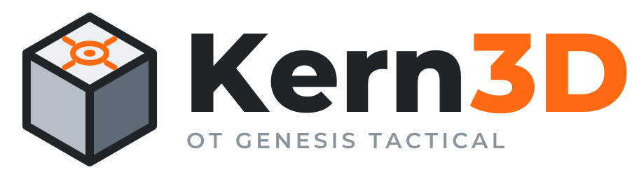

<p align="center">
  
</p>

<p align="center">
  <strong>Параметрическая 3D САПР, которая работает прямо в браузере.</strong><br>
  От Genesis Tactical · на основе <a href="https://github.com/xiangechen/chili3d">Chili3D</a>
</p>

<p align="center">
  <a href="https://genesishpa.github.io/kern3d/"><strong>Открыть онлайн-версию</strong></a> ·
  <a href="https://genesistactical.net/kern3d/">Страница проекта</a>
</p>

## Что это

Kern3D — бесплатная САПР для моделирования деталей: эскизы, параметрические тела, сборки и чертежи.
Геометрическое ядро OpenCascade (OCCT) скомпилировано в WebAssembly, поэтому все расчёты идут
на компьютере пользователя, а не на сервере. Ничего устанавливать не нужно.

Проекты хранятся в браузере (IndexedDB) на вашем компьютере. Чтобы перенести проект или сделать
резервную копию, сохраните его в файл.

## Что добавлено по сравнению с Chili3D

- Удобный интерфейс: рабочие пространства, вкладки инструментов, браузер модели слева,
  таймлайн снизу, ViewCube, круговое меню
- Настраиваемая панель инструментов: перетаскивание и закрепление команд
- Эскиз на грани с началом координат в точке клика (с привязкой к вершинам и центрам дуг)
- Фаска: равная, по двум расстояниям, по расстоянию и углу
- Резьба, инструменты анализа, чертежи
- Вспомогательная геометрия: оси, точки, касательные плоскости
- Сборки: компоненты и 7 типов сочленений с анимацией
- Примитивы, построенные на выбранной грани
- Бесплатные провайдеры для ИИ-помощника (Gemini, OpenRouter, Groq)
- Интерфейс на русском и английском языках

## Журнал изменений

Изменения по версиям: [CHANGELOG.md](CHANGELOG.md). Он же показывается в программе (колонка «Что нового» на главной странице) и в описании релизов.

## Запуск из исходников

```bash
npm install
npm run dev      # http://localhost:8080
npm run build    # сборка в папку dist/
npm run test     # тесты
```

Правила для разработки описаны в [AGENTS.md](./AGENTS.md).

## Лицензия

Kern3D — производная работа от [Chili3D](https://github.com/xiangechen/chili3d) (автор xiangechen, 仙阁).
TypeScript-код распространяется по лицензии [AGPL-3.0](./LICENSE), C++-часть (`cpp/`) — LGPL-3.0.
Исходный README оригинального проекта сохранён в [README.chili3d.md](./README.chili3d.md).

Шрифт Montserrat в логотипе распространяется по лицензии SIL Open Font License
([branding/kern3d-logo/final/Montserrat-OFL.txt](./branding/kern3d-logo/final/Montserrat-OFL.txt)).
