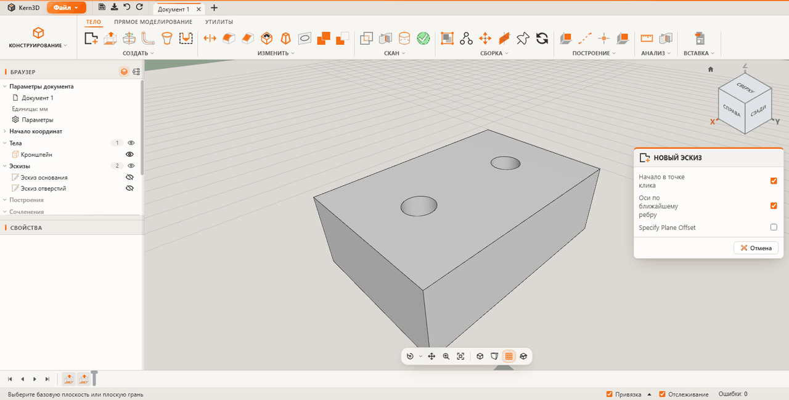
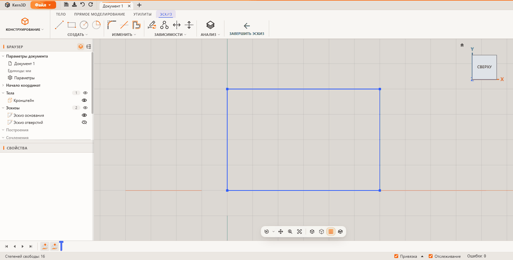
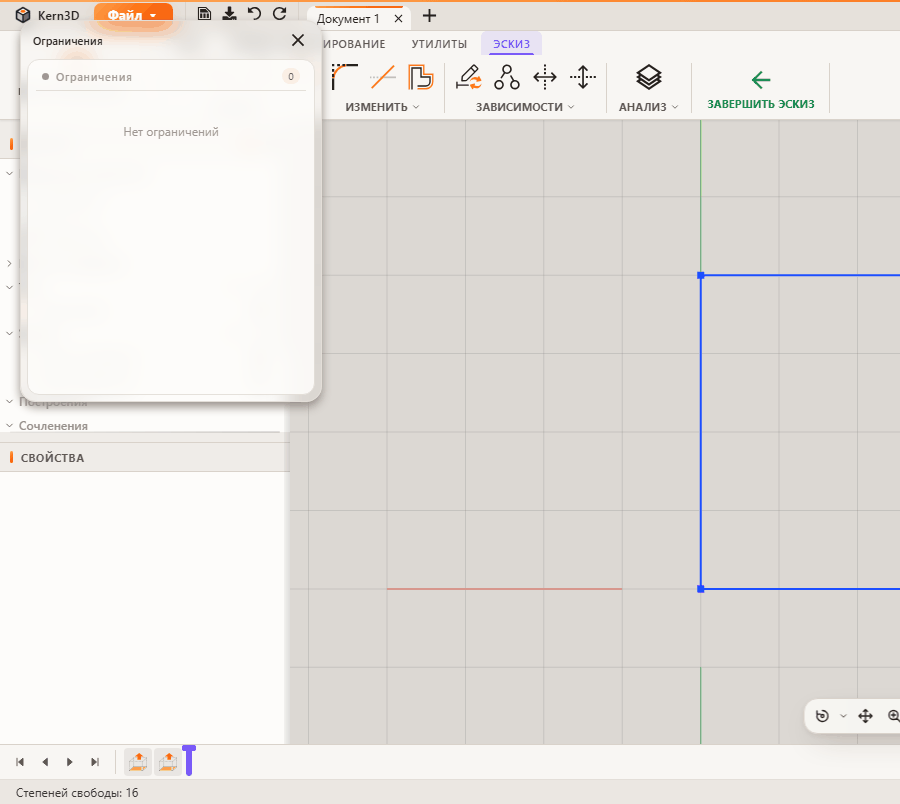

# Эскиз

Подробное руководство по 2D-эскизам: как создать эскиз на плоскости или грани, чем рисовать, как задать размеры и зависимости, как понять, что эскиз полностью определён, и почему «Выдавливание» не видит контур. Выдавливание, вращение и другие операции над эскизом описаны на странице [Тело (параметрическое моделирование)](05-body-parametric.md), навигация и выделение — в [Вид и выделение](03-view-and-selection.md).

## Содержание

1. [Что такое эскиз](#1-что-такое-эскиз)
2. [Создать эскиз (Новый эскиз)](#2-создать-эскиз-новый-эскиз)
   - [Выбор плоскости или грани](#21-выбор-плоскости-или-грани)
   - [Редактировать эскиз](#24-редактировать-эскиз-открыть-существующий)
   - [Завершить эскиз](#25-завершить-эскиз-выйти-из-эскиза)
3. [Вкладка «Эскиз» и общие приёмы](#3-вкладка-эскиз-и-общие-приёмы)
   - [Ввод точек и чисел с клавиатуры](#32-как-указывать-точки-и-вводить-числа)
   - [Автоматические зависимости](#33-автоматические-зависимости-привязки-при-рисовании)
   - [Клавиши Esc, Enter, Delete](#35-клавиши-esc-enter-delete)
4. [Рисование: группа «Создать»](#4-рисование-группа-создать)
5. [Редактирование: группа «Изменить»](#5-редактирование-группа-изменить)
6. [Зависимости (ограничения)](#6-зависимости-ограничения)
7. [Размеры](#7-размеры)
8. [Степени свободы, цвета, конфликты](#8-степени-свободы-цвета-конфликты)
9. [Вспомогательная геометрия и внешние ссылки](#9-вспомогательная-геометрия-и-внешние-ссылки)
10. [Профили: какой контур пойдёт в выдавливание](#10-профили-какой-контур-пойдёт-в-выдавливание)
11. [Проблемы и решения](#11-проблемы-и-решения)

---

## 1. Что такое эскиз

Эскиз — плоский чертёж на плоскости: линии, дуги, окружности, сплайны, текст. Из замкнутых контуров эскиза потом делают тело: **«Выдавливание»**, **«Вращение»** и другие операции.

Эскиз в Kern3D **параметрический**:

- **Зависимости** (горизонтально, перпендикулярно, касательная, совпадение…) задают, как элементы связаны между собой.
- **Размеры** задают длины, радиусы, углы и расстояния. Поменяли число — геометрия перестроилась, а за ней и тело.
- Решатель эскиза сам двигает точки так, чтобы выполнялись все зависимости и размеры.

В дереве (панель **«БРАУЗЕР»**) эскизы лежат в разделе **«Эскизы»**. Эскиз, по которому уже сделано выдавливание, скрывается, но остаётся в дереве — его можно открыть и поправить, тело перестроится.

## 2. Создать эскиз (Новый эскиз)

**«Тело» → «Создать» → «Новый эскиз»** (первая кнопка группы). Также есть в меню правого щелчка по пустому месту окна и по опорной плоскости, и в поиске команд.

1. Нажмите **«Новый эскиз»**. Внизу появится подсказка «Выберите базовую плоскость или плоскую грань».
2. Щёлкните плоскость (см. [2.1](#21-выбор-плоскости-или-грани)).
3. Эскиз создаётся и сразу открывается для редактирования: камера встаёт прямо над плоскостью (вид сверху, без перспективы), вращение вида выключается, появляется вкладка **«Эскиз»**.

Если уже был открыт другой эскиз, он сначала закрывается (с сохранением).

### 2.1. Выбор плоскости или грани

Что можно выбрать:

| Что | Как выглядит | Что запоминает эскиз |
|---|---|---|
| **Плоскость XY, YZ или ZX** | Три полупрозрачных квадрата в начале координат; под курсором квадрат становится ярче | Имя плоскости и смещение от неё |
| **Опорная плоскость**, созданная вами | Её квадрат | Ссылку на неё: правите плоскость — эскиз едет за ней |
| **Плоская грань тела** | Грань подсвечивается | Ссылку на грань: тело перестроилось — эскиз остаётся на той же грани |

- Квадраты XY/YZ/ZX рисуются поверх тел, поэтому до них можно дотянуться, даже если они за деталью. Под курсором квадрат важнее грани.
- Выбирается только **плоская** грань.
- При выборе грани её контур сразу попадает в эскиз как **внешние ссылки** — фиолетовые пунктирные линии. К ним удобно привязываться и ставить размеры; в профиль они не входят (подробнее — [раздел 9.3](#93-внешние-ссылки-проецировать-кромки)).

### 2.2. Параметры: начало в точке клика, оси по ребру

Пока ждёт выбора, команда показывает панель параметров:

| Поле | По умолчанию | Что делает |
|---|---|---|
| **Начало в точке клика** | включено | Начало координат эскиза ставится туда, где вы щёлкнули по грани; рядом с вершиной, серединой ребра или центром дуги (несколько пикселей) — точно в неё. Выключено — начало мира, спроецированное на грань |
| **Оси по ближайшему ребру** | включено | Оси X/Y эскиза идут вдоль ближайшего к щелчку прямого ребра грани |
| **Specify Plane Offset** (без перевода) | выключено | Включите, чтобы сдвинуть эскиз параллельно выбранной плоскости |
| **Plane Offset** (без перевода) | 0 | Расстояние сдвига, мм. Видно только при включённом предыдущем поле |

Первые два поля действуют только для граней; для XY/YZ/ZX и опорных плоскостей не влияют.

### 2.3. Эскиз со смещением от плоскости

1. В панели включите **Specify Plane Offset** (можно и во время выбора плоскости).
2. Выберите плоскость или грань.
3. Появится полупрозрачный квадрат с **стрелкой**: тяните стрелку — плоскость эскиза двигается по нормали. Или введите число в поле **Plane Offset** (можно выражение с параметрами документа).
4. Подтвердите (Enter или кнопка подтверждения).

Смещение потом можно поменять: выделите эскиз в дереве → панель **«СВОЙСТВА»** → поле **Plane Offset**.

### 2.4. Редактировать эскиз (открыть существующий)

Любой из способов:

- **Двойной щелчок** по эскизу в дереве.
- Правый щелчок по эскизу → **«Редактировать эскиз»**.
- **«Тело» → «Создать» ▾ → «Редактировать эскиз»** (в выпадающем списке группы). Если эскиз выделен — откроется он, иначе программа попросит «Выберите эскиз».

Пока эскиз открыт:

- Тела, построенные **после** этого эскиза, показываются в том виде, какими они были в момент создания эскиза (операции после него временно скрыты). Так вы видите ту геометрию, на которой эскиз рисовали. При выходе всё перестраивается. Если откатить не удалось: «Некоторые тела не удалось откатить к позиции эскиза».
- Эскиз рисуется поверх тел, даже если он за ними.

### 2.5. Завершить эскиз (выйти из эскиза)

- Большая кнопка **«Завершить эскиз»** в конце вкладки «Эскиз»;
- или **Esc**, когда ничего не выбрано и никакой инструмент не работает (см. [3.5](#35-клавиши-esc-enter-delete));
- или правый щелчок по пустому месту → круговое меню → **«Завершить эскиз»**.

Изменения сохраняются в любом случае — отдельного «Сохранить эскиз» нет. Отменить всё сделанное внутри — **Ctrl+Z** (каждое действие в эскизе — отдельный шаг отмены).

## 3. Вкладка «Эскиз» и общие приёмы

### 3.1. Где кнопки

Вкладка **«Эскиз»** появляется только пока эскиз открыт и исчезает при выходе. Группы:

| Группа | Иконки на ленте | Ещё в выпадающем списке группы (имя группы ▾) |
|---|---|---|
| **Создать** | Линия, Прямоугольник, Окружность, Дуга | Многоугольник, Эллипс, Дуга эллипса, Сплайн, Безье, Коника, Точка, Текст, Проецировать кромки, Переключить роль ссылки, Переключить построение |
| **Изменить** | Скругление, Обрезать, Смещение | Фаска, Удлинить, Разбить, Зеркало, Преобразовать, Массив |
| **Зависимости** | Размер, Совпадение, Горизонтально, Вертикально | Фиксировать точку, Параллельно, Перпендикулярно, Равенство, Касательная, Симметрия, Середина, Точка на объекте, Выровнять по горизонтали, Выровнять по вертикали, Задающий / Измерительный, Расстояние, Радиус, Угол, Расстояние точка-линия, Горизонтальное расстояние, Вертикальное расстояние |
| **Анализ** | Список зависимостей | — |
| **Завершить эскиз** | одна большая кнопка | — |

Иконки на ленте можно переставить: перетащить из выпадающего списка или включить/выключить в списке («Показать на панели» / «Убрать с панели»; «Сбросить расположение значков» возвращает как было) — подробнее в [Начало работы и интерфейс](01-start-and-interface.md).

Правый щелчок по пустому месту в эскизе открывает **круговое меню**: Завершить эскиз, Линия, Окружность, Прямоугольник, Обрезать, Размер, Отменить, Повторить последнюю команду.

У инструментов эскиза нет собственных горячих клавиш. **Пробел** или **Enter**, когда ни один инструмент не работает, — «Повторить последнюю команду».

### 3.2. Как указывать точки и вводить числа

**Щелчком.** Курсор цепляется (привязывается) к ближайшей точке, линии, окружности, осям эскиза; рядом с курсором показывается значок зависимости, которая будет добавлена (см. [3.3](#33-автоматические-зависимости-привязки-при-рисовании)). Рядом с курсором показывается текущая длина / диаметр / размеры.

**С клавиатуры.** Когда инструмент ждёт следующую точку, начните набирать число (цифра, `-` или `#`) — откроется поле ввода. Enter подтверждает.

| Что набрать | Что получится |
|---|---|
| `50` | Точка на расстоянии 50 мм от предыдущей **в направлении курсора**. Для линии — длина, для окружности — **диаметр**, для дуги на втором шаге — радиус. Инструмент сразу ставит на элемент **размер** с этим значением |
| `30,20` | Смещение по X и Y эскиза от предыдущей точки. Знак берётся по тому, с какой стороны курсор. Для прямоугольника — **ширина и высота**: на прямоугольник ставятся оба размера |
| `#10,5,0` | Точка по абсолютным координатам X, Y, Z (три числа) |

Ошибки ввода: «Вводите номера, разделенные запятой ','», «Не заполнена котрольная точка, нужно только 3 номера», «Достигнут предел вводимых номеров» (для этого шага столько чисел ввести нельзя — например, одно число для прямоугольника).

Числовые поля панелей инструментов (радиус скругления, расстояние смещения и т.д.) принимают и **выражения** с параметрами документа (см. [7.3](#73-изменить-значение-размера-переменные-и-выражения)).

### 3.3. Автоматические зависимости (привязки при рисовании)

Когда вы ставите элемент, программа сама добавляет зависимости там, где курсор «прилип»:

- конец рядом (8 пикселей) с другой точкой или началом координат → **Совпадение**;
- точка рядом с линией, окружностью, дугой или осью эскиза → **Точка на объекте**;
- линия почти горизонтальна или вертикальна (до 5°) → **Горизонтально** / **Вертикально**;
- элемент почти касается линии, окружности, дуги → **Касательная**.

То же происходит, когда вы **тащите точку** мышью и отпускаете её рядом с чем-то. Отпустили и зависимость не нужна — **Ctrl+Z** или удалите её (см. [3.4](#34-выделение-перетаскивание-удаление)).

Чтобы рисовать без «прилипания», рисуйте подальше от другой геометрии и потом подтяните точку — или отключите привязку («Привязка ▲» в строке состояния, см. [Вид и выделение](03-view-and-selection.md)).

### 3.4. Выделение, перетаскивание, удаление

- **Щелчок** по элементу — выделить, **Shift+щелчок** — добавить/убрать из выделения.
- **Рамка** с пустого места — выделяет всё, что рамка задела (целиком внутри или пересекает).
- **Перетащить точку** (конец линии, центр окружности…) — решатель двигает геометрию с учётом зависимостей. Не перетаскиваются: начало координат, внешние ссылки, копии массива.
- **Подпись размера** можно перетащить на другое место; щелчок — выделить размер; **двойной щелчок** — изменить значение.
- **Значки зависимостей** (H, V, ⊥, ∥, =, касательная, совпадение…) появляются рядом с элементом, когда на него навели курсор или выделили его. Близкие значки собираются в «стопку» — наведите, чтобы раскрыть. Конфликтующие и избыточные значки видны всегда.
- **Delete** / **Backspace** удаляет: в первую очередь зависимость или размер **под курсором**, потом выделенные зависимости, потом элемент под курсором, потом выделенные элементы. Вместе с элементом удаляются все его зависимости.

> ⚠️ Delete сначала удаляет то, что **под курсором**, а не то, что выделено. Уберите курсор с геометрии перед нажатием, если хотите удалить выделенное.

### 3.5. Клавиши Esc, Enter, Delete

**Esc** снимает по одному слою за нажатие:

1. отменяет перетаскивание точки (точка возвращается);
2. отменяет рамку выделения или перенос подписи размера;
3. отменяет текущий шаг инструмента (у линии — заканчивает цепочку; ещё одно Esc — выходит из инструмента);
4. снимает выделение зависимостей;
5. снимает выделение элементов;
6. **выходит из эскиза** (с сохранением).

> ⚠️ Поэтому лишнее Esc закрывает эскиз. Ничего не теряется — откройте снова двойным щелчком по эскизу в дереве.

**Правый щелчок** во время выбора — то же, что Esc для текущего шага.

**Enter** (и пробел) в рисующих инструментах заканчивает текущую цепочку, как Esc. В «Смещении», «Преобразовать», «Массиве», «Проецировать кромки» — подтверждает.

**✗** на панели параметров инструмента сразу закрывает инструмент.

### 3.6. Размер выбранного элемента (панель внизу слева)

Выделите **одну** линию, окружность или дугу — в левом нижнем углу окна появится поле: **«Длина»**, **«Диаметр Ø»** или **«Радиус R»**, единицы **«мм»**.

- Введите число и нажмите **Enter** — элемент примет этот размер. Если размер уже стоит — он изменится; если нет — добавится новый.
- **Esc** в поле — вернуть текущее значение.
- «Размер должен быть больше нуля» — ввели 0 или отрицательное.
- «Этот размер уже задан другими ограничениями» — размер и так определён зависимостями; новый не добавлен.
- Если размер на элементе измерительный — поле только показывает значение (см. [7.2](#72-задающий-и-измерительный-размер)).

## 4. Рисование: группа «Создать»

Общее для всех рисующих инструментов:

- Флажок **«Построение»** на панели — нарисованное станет вспомогательной геометрией (пунктир, в профиль не входит, см. [9.1](#91-вспомогательная-геометрия-построение)).
  > ⚠️ Флажок **общий для всех инструментов и запоминается**: включили в «Линии» — он включён и в «Окружности», и в следующий раз. Если вдруг всё рисуется пунктиром — снимите галочку.
- После каждого элемента инструмент остаётся активным — рисуйте следующий. Выход — Esc (иногда дважды) или ✗.
- Подсказка текущего шага — в строке состояния внизу.

### 4.1. Линия (отрезок, ломаная)

**«Эскиз» → «Создать» → «Линия»**. Рисует **цепочку** отрезков.

1. Щёлкните начальную точку («выберите точку начала»).
2. Щёлкайте следующие точки — каждый щелчок добавляет отрезок, концы соседних отрезков связаны **Совпадением** («pick the next point, ESC or Enter to finish the chain» — подсказка без перевода).
3. Щелчок в **начальную точку** цепочки замыкает контур и заканчивает цепочку.
4. **Esc** или **Enter** — закончить цепочку без замыкания. Инструмент остаётся активным для новой цепочки; ещё одно **Esc** — выход из инструмента.

Ввод с клавиатуры: `50` — отрезок длиной 50 мм в направлении курсора (ставится размер длины), `30,20` — отрезок со смещением 30 по X и 20 по Y.

### 4.2. Прямоугольник

**«Эскиз» → «Создать» → «Прямоугольник»** (кнопка с выпадающим вариантом «Многоугольник»).

1. Щёлкните первый угол.
2. Щёлкните противоположный угол — рядом с курсором видны ширина и высота. Или наберите `ширина,высота`, например `60,40`, — на прямоугольник сразу встанут размеры ширины и высоты.

Получаются 4 линии со **Совпадением** в углах и **Горизонтально** / **Вертикально** на сторонах. Прямоугольник всегда по осям эскиза; режимов «от центра» и «повёрнутый» нет — для центрированного прямоугольника поставьте **Симметрию** углов относительно оси, для повёрнутого — уберите H/V и задайте угол.

Слишком маленький: «Rectangle sides are too small» (без перевода).

### 4.3. Многоугольник (правильный шестиугольник и т.п.)

**«Эскиз» → «Создать» ▾ → «Многоугольник»** (вариант кнопки «Прямоугольник»).

| Поле | По умолчанию | Что значит |
|---|---|---|
| **Число сторон** | 6 | Не меньше 3 |
| **Режим многоугольника** | Вписанный | **Вписанный** — вторая точка = вершина (радиус по вершинам). **Описанный** — вторая точка = середина стороны (радиус до стороны, «под ключ») |

1. Щёлкните центр.
2. Щёлкните точку радиуса («введите радиус») или наберите число.

Создаются стороны-линии и вспомогательная окружность через вершины (в описанном режиме — ещё одна, вписанная). Окружность держит многоугольник правильным: тянете вершину — фигура остаётся правильной. Набранное число становится размером радиуса той окружности, которую вы задавали.

### 4.4. Окружность

**«Эскиз» → «Создать» → «Окружность»**.

1. Щёлкните центр («выберите центр»).
2. Щёлкните точку на окружности («введите диаметр») — рядом с курсором виден Ø. Или наберите число — это **диаметр**; ставится размер Ø.

### 4.5. Эллипс

**«Эскиз» → «Создать» ▾ → «Эллипс»** (вариант кнопки «Окружность»).

1. Центр эллипса.
2. Точка большой оси (задаёт длину и направление).
3. Точка малой оси — берётся только расстояние, малая ось всегда перпендикулярна большой.

Набранное на втором шаге число ставит размер «центр — конец большой оси».

### 4.6. Дуга (по центру, началу и концу)

**«Эскиз» → «Создать» → «Дуга»**.

1. Центр.
2. Начальная точка — задаёт радиус («выберите точку начала»). Набранное число — радиус (ставится размер R).
3. Конечная точка («выберите точку завершения») — дуга идёт **против часовой стрелки** от начала к концу; точка проецируется на окружность.

Другого способа (по трём точкам, касательной) нет: дуга по трём точкам строится как дуга по центру плюс зависимость «Точка на объекте», касательная — дуга плюс **Касательная**.

Сообщения (без перевода): «Arc end point is too close to the center», «Arc end point is on the start ray (zero sweep)» — конец совпал с центром или лёг на луч начала.

### 4.7. Дуга эллипса

**«Эскиз» → «Создать» ▾ → «Дуга эллипса»** (вариант кнопки «Дуга»). Пять щелчков: центр → точка большой оси → точка малой оси → начальная точка → конечная точка (против часовой стрелки, точки ложатся на эллипс).

### 4.8. Сплайн (NURBS)

**«Эскиз» → «Создать» ▾ → «Сплайн»**.

Сплайн рисуется по **управляющим точкам**: кривая проходит через первую и последнюю, а к остальным только «тянется» (как в Onshape, SolidWorks). Управляющий многоугольник рисуется пунктиром.

1. Щёлкайте управляющие точки одну за другой.
2. **Esc** или **Enter** — закончить; сплайн создаётся одним элементом (одно действие для отмены).
3. Щелчок в первую точку — замкнутый сплайн.
4. ✗ на панели — бросить недорисованный сплайн.

Сплайн кубический (при 4 и более точках). Форму потом меняют, перетаскивая управляющие точки.

### 4.9. Безье (цепочка кубических кривых)

**«Эскиз» → «Создать» ▾ → «Безье»**. Как сплайн — щёлкаете управляющие точки, кривая тянется к ним, — но результат режется на отдельные кубические сегменты Безье. Сегменты стыкуются плавно: в стыке **Совпадение** и три точки (стык и две соседние «ручки») на одной прямой. Удалите эту зависимость — стык станет углом. Щелчок в первую точку (при 4+ точках) замыкает цепочку, Esc/Enter — заканчивает.

### 4.10. Коника

**«Эскиз» → «Создать» ▾ → «Коника»**. Кривая второго порядка (как в Onshape/NX).

1. Начальная точка.
2. Конечная точка.
3. Контрольная точка — куда «тянутся» касательные.
4. Опорная точка («задаёт rho») — насколько кривая «полная». rho берётся от 0,05 до 0,95.

Потом rho меняется размером: **«Размер»** → щёлкнуть конику → поставить → значение **Rho** (строго между 0 и 1).

### 4.11. Точка

**«Эскиз» → «Создать» ▾ → «Точка»**. Одиночные точки — щелчок за щелчком, до Esc. Точка не участвует в профиле, но к ней можно привязываться и ставить размеры: центры отверстий, точки под разметку. Поставленная рядом с геометрией точка прилипает к ней (Совпадение / Точка на объекте).

### 4.12. Текст

**«Эскиз» → «Создать» ▾ → «Текст»**.

| Поле | По умолчанию | Что значит |
|---|---|---|
| **Текст** | Text | Строка. Превью меняется сразу |
| **Высота** | 20 мм | Высота букв, если второй щелчок не задал её |
| **Шрифт** | шрифт по умолчанию | Выбор из списка или свой файл шрифта |

1. Щёлкните начало строки (левый край базовой линии).
2. Щёлкните верх букв: расстояние = высота, направление = «вверх» для букв. Потяните прямо вверх — получится горизонтальная надпись.

Буквы — настоящие контуры: они выдавливаются вместе с профилем (выпуклая или вырезанная надпись). Пересекающиеся штрихи шрифта сливаются, чтобы не получалось лишних дыр.

**Изменить текст** — двойной щелчок по надписи → окно «Изменить текст»: **Текст**, **Высота**, **Угол**, **Шрифт** → «Подтвердить».

Текст нельзя обрезать, разбивать или удлинять. «Не удалось загрузить шрифт текста» — шрифт не загрузился (нет сети / испорчен файл), выберите другой.

### 4.13. Проецировать кромки, Переключить роль ссылки, Переключить построение

Эти три команды — про вспомогательную и внешнюю геометрию, описаны в [разделе 9](#9-вспомогательная-геометрия-и-внешние-ссылки).

## 5. Редактирование: группа «Изменить»

Сообщения об отказе этих инструментов пока выводятся по-английски — самые частые переведены в [Проблемах](#11-проблемы-и-решения).

### 5.1. Скругление угла (fillet)

**«Эскиз» → «Изменить» → «Скругление»**. Скругляет угол между **двумя линиями**, у которых общий конец.

| Поле | По умолчанию |
|---|---|
| **Радиус** | 10 мм (можно выражение) |

- Если линии уже выделены (две и больше, например рамкой весь контур), скругляются **все** их углы сразу, команда заканчивается.
- Если ничего не выделено: щёлкайте линии; как только набирается пара с общим углом — угол скругляется. Можно выделить рамкой. Esc — конец.

Результат: дуга, касательная к обеим линиям, и **размер радиуса** на ней (задающий — потом меняйте двойным щелчком). Если не помещается, не скругляется ни один угол из набора.

Только линии: дуги, сплайны так не скругляются (сделайте дугу и поставьте **Касательную**).

### 5.2. Фаска

**«Эскиз» → «Изменить» ▾ → «Фаска»** (вариант кнопки «Скругление»). Так же, как скругление, но срезает угол отрезком.

| Поле | По умолчанию |
|---|---|
| **Длина** | 10 мм — сколько отрезать от угла по каждой линии |

Фаска равная по обеим сторонам. На срез и на укороченные стороны ставятся размеры.

### 5.3. Обрезать (trim)

**«Эскиз» → «Изменить» → «Обрезать»**. Щёлкните кусок элемента, который надо убрать: удаляется участок между ближайшими пересечениями слева и справа от щелчка (или до конца). При наведении убираемый кусок подсвечивается.

- Инструмент остаётся активным, каждый щелчок — отдельный шаг отмены. Esc — выход.
- Зависимости, которые перестали иметь смысл, удаляются: «При обрезке удалено ограничений: N».
- Нельзя обрезать точку, текст, начало координат и внешние ссылки.

### 5.4. Смещение (offset, эквидистанта)

**«Эскиз» → «Изменить» → «Смещение»**. Делает копию линий/дуг/окружностей/кривых на заданном расстоянии, **связанную с исходной**: двигаете исходник или меняете расстояние — копия следует.

1. Выделите элементы — щелчком или рамкой (можно до запуска). На выделенном появится **стрелка** и пунктирное превью.
2. Тяните стрелку — расстояние меняется. Или наберите число на клавиатуре / в поле **«Расстояние»** на панели (можно выражение).
3. Можно добавлять элементы в выделение — расстояние применяется ко всем.
4. **Enter** или кнопка подтверждения — создать. **Esc** — отмена.

Направление: положительное расстояние — влево от линии, к центру дуги, наружу от окружности; стрелка показывает, куда уйдёт копия. Смежные элементы цепочки смещаются с соединёнными углами.

На копии ставится подпись «Смещение N — двойной щелчок, чтобы изменить».

Сообщения: «N углов не удалось соединить: смещённые кривые остаются врозь», «Выбранные рёбра сходятся в N углах, которые нельзя соединить — они смещаются по отдельности» (развилка из трёх и больше элементов в одной точке). «The offset distance is more than the radius» — внутрь окружности на расстояние больше радиуса.

### 5.5. Удлинить (extend)

**«Эскиз» → «Изменить» ▾ → «Удлинить»**.

| Поле | По умолчанию | Что значит |
|---|---|---|
| **Изменить границу** | включено | Граница тоже подрезается/удлиняется до угла — «сведите два элемента в угол» одним действием |

1. Щёлкните элемент, который надо удлинить, — ближе к тому концу, который двигать.
2. Щёлкните границу, до которой удлинять.

Конец уходит по своей линии/окружности до пересечения и закрепляется там. Инструмент остаётся активным: удобно замыкать контур угол за углом. «The two entities do not meet when extended» — элементы не пересекутся даже при продолжении.

### 5.6. Разбить (break)

**«Эскиз» → «Изменить» ▾ → «Разбить»**. Делит элемент на два в точке щелчка; половинки связаны **Совпадением**, точка разбиения становится настоящей вершиной (к ней можно привязываться).

- Линия, дуга — один щелчок.
- Окружность, эллипс (замкнутые) — два щелчка: «выберите вторую точку на замкнутой кривой».
- Щёлкать нужно не в конец элемента. Точку и текст разбить нельзя.

### 5.7. Зеркало (отразить)

**«Эскиз» → «Изменить» ▾ → «Зеркало»**.

1. Щёлкните **линию отражения** — линию эскиза (часто — вспомогательную) или ось X / Y эскиза.
2. Щёлкайте элементы (или обводите рамкой) — копия появляется сразу. Esc — конец.

Если элементы выделены заранее — после выбора линии они отражаются все сразу. Копии связаны с исходниками **Симметрией**: правите исходник — копия следует. Элементы, уже симметричные относительно этой линии, пропускаются: «При отражении пропущено сущностей, уже симметричных относительно линии: N».

### 5.8. Преобразовать (переместить, повернуть, масштабировать)

**«Эскиз» → «Изменить» ▾ → «Преобразовать»**. Двигает выделенную геометрию как одно целое (не копирует).

1. Выделите элементы щелчком или рамкой — на них появятся маркеры.
2. Тяните маркер:
   - **стрелки** — сдвиг вдоль X или Y эскиза;
   - **квадратик** между стрелками — свободный сдвиг;
   - **дуга с шариком** — поворот (градусы, против часовой);
   - **треугольник** — масштаб (2 — вдвое больше, 0,5 — вдвое меньше);
   - **кружок** в центре — перенести точку, вокруг которой поворот и масштаб.
   Значение можно набрать в поле у курсора.
3. **Enter** или кнопка подтверждения — применить всё одним шагом отмены. Esc — отмена.

Зависимости, которые после перемещения выполняться не могут, удаляются: «При преобразовании удалено ограничений: N».

### 5.9. Массив (linear / circular / по кривой)

**«Эскиз» → «Изменить» ▾ → «Массив»**. Размножает выделенные элементы. Массив хранится как **правило**: правите исходный элемент или число — все копии перестраиваются.

| Поле | Значения |
|---|---|
| **Тип шаблона** | **По линии** (сетка вдоль осей X и Y эскиза; по умолчанию 3 × 1, шаг 60 мм), **По кругу** (вокруг начала эскиза; 3 шт., общий угол 360°, флажок «Равномерно»), **По кривой** (сначала щёлкнуть кривую; 3 шт., шаг 20 мм) |

1. Выделите элементы (щелчком или рамкой; «выберите объекты для массива (щелчком или рамкой), ESC или Enter — конец»).
2. Выберите тип. Превью копий — пунктиром.
3. Числа массива показаны прямо на чертеже: «N экземпляров — двойной щелчок для правки числа», «Шаг N — двойной щелчок для правки», «N на весь массив — двойной щелчок для правки». Двойной щелчок по подписи — ввод значения.
4. Подтвердите (Enter или кнопка подтверждения).

«Равномерно» для кругового: угол делится так, что при 360° последняя копия не ложится на первую (4 шт. — через 90°).

Готовый массив:

- **Двойной щелчок по копии** — открыть массив на редактирование; на панели появятся кнопки **«Удалить массив»** («Массив и его копии удалены») и **«Расформировать массив»** (копии становятся обычной геометрией: «Массив расформирован — его копии теперь обычная геометрия эскиза»).
- **Удалить копию** (Delete) — копия убирается из массива, остальные остаются на местах: «Из массива убрано экземпляров: N».
- Копию нельзя двигать или переключать в построение: «Экземпляр массива следует за массивом — измените или удалите массив».

## 6. Зависимости (ограничения)

Группа **«Эскиз» → «Зависимости»**. Каждая команда добавляет **одну** зависимость и заканчивается. Подсказки: «выберите точку эскиза», «выберите элемент эскиза». Начало координат и оси X/Y эскиза тоже можно выбирать там, где сказано.

| Команда | Что выбрать | Что делает |
|---|---|---|
| **Совпадение** | две точки | Сводит точки в одну |
| **Горизонтально** | линию (или отрезок управляющего многоугольника сплайна) | Делает горизонтальной |
| **Вертикально** | линию | Делает вертикальной |
| **Фиксировать точку** | точку | Закрепляет на текущих координатах X, Y; двойной щелчок по значку — ввести координаты |
| **Параллельно** | две линии (или ось) | Параллельны |
| **Перпендикулярно** | две линии (или ось) | Под 90° |
| **Равенство** | два элемента одного типа | Равная длина (линии) или равный радиус (окружности, дуги) |
| **Касательная** | два элемента, не две линии | Касание линии/окружности/дуги/эллипса/сплайна |
| **Симметрия** | две точки, потом линию или ось | Точки симметричны относительно линии |
| **Середина** | точку, потом линию | Точка — середина линии |
| **Точка на объекте** | точку, потом линию/окружность/дугу/кривую или ось | Точка лежит на элементе |
| **Выровнять по горизонтали** | две точки | Одинаковая Y |
| **Выровнять по вертикали** | две точки | Одинаковая X |
| **Задающий / Измерительный** | заранее выделенные размеры | См. [7.2](#72-задающий-и-измерительный-размер) |

Сообщения:

- «Ограничение уже существует» — такая зависимость уже есть.
- «Эта точка уже лежит на элементе — ограничение ничего не добавит».
- «Эта точка — конец самой линии; для середины нужна точка вне линии».
- «Эта точка — центр, задающий размер элемента; привязка её к самому элементу сожмёт его в ничто».
- «Ограничение середины уже удерживает эту точку на линии — точка на линии не нужна».
- «Середина уже удерживает эту точку на этой линии — две точки совпадут, только если линия сожмётся».
- «Эта точка — такая, через которую собственная кривая элемента не проходит…» — например, управляющая точка сплайна.
- «Две точки совпали, поэтому повторяющее их ограничение «точка на линии» удалено» и «Середина удерживает эту точку на линии, поэтому повторяющее её ограничение «точка на линии» удалено» — лишняя старая зависимость убрана автоматически (одним шагом отмены с новой).
- «Внешняя ссылка — это зафиксированная геометрия; этому ограничению нужен хотя бы один объект эскиза» — нельзя связывать две внешние ссылки между собой.
- Без перевода: «Pick two different entities», «Equal requires two entities of the same type» (окружность и дугу уравнять нельзя), «Equal applies to lines, circles and arcs», «Tangent does not apply to two lines».

Удалить зависимость: навести на её значок и **Delete**, или крестик в «Списке зависимостей».

## 7. Размеры

### 7.1. Размер (универсальный) и отдельные виды размеров

**«Эскиз» → «Зависимости» → «Размер»** — главный инструмент: сам понимает, что за размер нужен.

1. Щёлкните один или два объекта («выберите геометрию для размера; щёлкните по пустому месту, чтобы поставить, ESC для отмены»). Превью размера идёт за курсором.
2. Щёлкните **пустое место** — там встанет подпись.
3. Откроется окно «Введите значение» с текущим значением — введите нужное → **«Подтвердить»**. **«Отмена»** — размер не ставится.

Инструмент остаётся активным для следующего размера. Esc с выбранными объектами — сбросить выбор, Esc без выбора — выход.

Что получится:

| Выбрано | Размер |
|---|---|
| одна линия | длина |
| одна окружность | диаметр (Ø) |
| одна дуга | радиус (R) |
| эллипс, дуга эллипса | большая полуось |
| коника | Rho |
| две точки | расстояние; куда увести подпись — такое и будет: вдоль (по прямой), по горизонтали или по вертикали |
| точка и линия | расстояние по перпендикуляру |
| две непараллельные линии | угол |
| две параллельные линии | расстояние между ними |
| две окружности/дуги | расстояние между центрами |

Если элементы выделены заранее (не больше двух) — остаётся только поставить подпись. «Для нанесения размера выберите не более двух объектов», «Между этими объектами нет размера» — выделение не подходит.

Отдельные инструменты (в выпадающем списке группы) делают ровно один вид размера:

| Команда | Что выбрать |
|---|---|
| **Расстояние** | две точки, потом место подписи |
| **Радиус** | окружность или дугу, потом место |
| **Угол** | две линии (или ось), потом место — сторона подписи выбирает угол или дополнительный к нему |
| **Расстояние точка-линия** | точку и линию |
| **Горизонтальное расстояние** | две точки — разница по X |
| **Вертикальное расстояние** | две точки — разница по Y |

Флажок **«Измерительный»** на панели всех размерных инструментов — ставить сразу измерительные размеры (флажок общий и запоминается).

### 7.2. Задающий и измерительный размер

- **Задающий** (обычный) — управляет геометрией: меняете число — геометрия меняется.
- **Измерительный** (driven, справочный) — только показывает текущее значение, ничего не ограничивает. Рисуется серым, значение в скобках. Подсказка: «Измерительный размер измеряет геометрию, не ограничивая её».

Переключить: щёлкните подпись размера (Shift — несколько) → **«Зависимости» ▾ → «Задающий / Измерительный»**. Если ничего не выбрано: «Выберите размер, чтобы переключить его между задающим и измерительным».

Размер становится измерительным **автоматически**, без окна ввода, если:

- он повторяет то, что уже задано (например, третий размер треугольника, у которого уже есть две стороны и угол) — вместо конфликта Kern3D делает его справочным;
- он ставится только между внешними ссылками.

Двойной щелчок по измерительному размеру: «Измерительный размер доступен только для чтения — переключите его обратно в задающий, чтобы изменить».

### 7.3. Изменить значение размера, переменные и выражения

**Двойной щелчок** по подписи размера (или по строке в «Списке зависимостей») → окно «Введите значение» → «Подтвердить». Для «Фиксировать точку» — два поля X и Y.

В поле можно ввести:

- число: `25`;
- имя параметра документа: `ширина`;
- выражение: `ширина/2 + 5`, `2*толщина`, `sqrt(a*a+b*b)`.

Параметры создаются в окне **«Тело» → «Изменить» ▾ → «Изменить параметры»** (у каждого — имя, тип: длина / угол / без единиц, выражение). Поменяли параметр — все размеры и эскизы с ним перестраиваются, даже если эскиз сейчас открыт. Подробно — на странице [Тело](05-body-parametric.md).

Ошибки в окне: неизвестное имя, недопустимое значение (длина и радиус — только больше нуля; горизонтальное/вертикальное расстояние может быть со знаком минус — это сторона; Rho — между 0 и 1). Окно не закроется, пока значение не подходит. Если параметр позже удалили и выражение перестало считаться — строка размера в «Списке зависимостей» помечается, во всплывающей подсказке — причина.

Набранное выражение хранится как выражение (не заменяется числом).

## 8. Степени свободы, цвета, конфликты

### 8.1. Строка состояния: степени свободы

После каждого изменения внизу пишется состояние эскиза:

| Текст | Что значит |
|---|---|
| «Степеней свободы: N» | Эскиз определён не полностью: геометрию можно двигать N независимыми способами. Добавьте размеры/зависимости |
| «Полностью ограничен» | Всё задано, ничего не «гуляет» |
| «Конфликтующие ограничения» | Зависимости противоречат друг другу, выполнить все нельзя |
| «Эскиз не удалось решить — это изменение не применилось» | Решатель не справился (например, слишком резкое изменение размера); геометрия осталась прежней. Измените значение меньшими шагами или уберите лишнюю зависимость |

Не обязательно доводить эскиз до «Полностью ограничен» — выдавливание работает и с недоопределённым эскизом. Но полностью определённый эскиз предсказуемо перестраивается при изменении размеров.

### 8.2. Цвета на чертеже

| Цвет | Что это |
|---|---|
| **Синий** | Элемент определён не полностью — его можно сдвинуть |
| **Чёрный** (в тёмной теме — белый) | Элемент полностью определён |
| Пунктир стально-синий | Вспомогательная геометрия («Построение») |
| Фиолетовый пунктир | Внешняя ссылка (Ссылочная) |
| Фиолетовый сплошной | Внешняя ссылка с ролью «Профиль» |
| **Красный** (ссылка) | Внешняя ссылка потеряла источник |
| Размер синий | Обычный задающий размер |
| Размер серый, в скобках | Измерительный |
| Размер / значок **красный** | Конфликтующий |
| Размер / значок **жёлтый (янтарный)** | Избыточный — повторяет то, что уже задано |
| Зелёный | Выделенный размер |

### 8.3. Список зависимостей (constraints panel)

**«Эскиз» → «Анализ» → «Список зависимостей»** — плавающая панель «Ограничения» (нажать ещё раз — закрыть).

- В заголовке — число зависимостей и цветная точка: **зелёная** — полностью ограничен, **жёлтая** — есть избыточные, **красная** — есть конфликт.
- Строки: значок, номер и название («#3 Горизонтально», «#7 Диаметр»), значение размера, крестик — удалить.
- Наведение на строку подсвечивает её элементы на чертеже; щелчок — выделить (Shift — добавить); двойной щелчок по размеру — изменить значение.
- Конфликтующие строки помечены «Конфликт», избыточные — «Избыточное».
- «Нет ограничений» — эскиз пуст.

Служебные связи, которые инструменты ставят сами внутри элемента (например, концы дуги на её окружности), в списке не показываются.

### 8.4. Конфликт и избыточность: как найти виновника

**Конфликт** — зависимости противоречат: например, размер 50 и «Равенство» с линией 40. **Избыточная** зависимость ничего не противоречит, но повторяет уже заданное (две «Горизонтально» на одной линии через разные пути).

1. Откройте «Список зависимостей».
2. Если есть конфликт или избыточность — появится кнопка **«Find the culprit»** (без перевода). Нажмите: программа пробует удалять по одной и пишет, например:
   - «Delete any one of #3, #7 to clear the conflict» — удалите **любую одну** из названных;
   - «These constraints hold each other up: deleting any single one leaves the conflict. Remove a combination.» — одной удалённой мало, удалите несколько;
   - «A dimension has driven #5 down to nothing…» — размер сжал элемент до нуля: исправьте значение размера, удаление не поможет;
   - «Only the first N constraints were tried — the answer may be incomplete» — проверены не все.
3. Удалите (крестик в строке) или сделайте размер измерительным.

Проще всего избегать конфликта, сразу отменяя (**Ctrl+Z**) действие, после которого появилось «Конфликтующие ограничения».

## 9. Вспомогательная геометрия и внешние ссылки

### 9.1. Вспомогательная геометрия (построение)

Вспомогательные (конструктивные) элементы рисуются **пунктиром**, участвуют в зависимостях и привязках, но **не входят в профиль** — по ним ничего не выдавливается. Типичные: ось симметрии для «Зеркала», окружность центров отверстий, средняя линия.

- Нарисовать сразу вспомогательной — флажок **«Построение»** на панели инструмента (см. [раздел 4](#4-рисование-группа-создать)).
- **Переключить построение**: **«Эскиз» → «Создать» ▾ → «Переключить построение»**.
  - Если элементы выделены — переключаются все сразу, команда заканчивается.
  - Если нет — щёлкайте элементы по одному («выберите геометрию эскиза для переключения построения, ESC для завершения»), каждый переключается сразу.
  - Внешние ссылки так не переключаются — у них своя команда (9.4).

### 9.2. Точки и начало координат

Начало координат эскиза и оси X/Y можно использовать в зависимостях и размерах («Совпадение» с началом, «Симметрия» относительно оси Y и т.д.). Их нельзя двигать и удалять.

### 9.3. Внешние ссылки: Проецировать кромки

**«Эскиз» → «Создать» ▾ → «Проецировать кромки»**. Переносит кромки тел в эскиз как **внешние ссылки** — к ним можно привязываться и ставить размеры, а при изменении тела они обновляются.

| Поле | По умолчанию | Что значит |
|---|---|---|
| **Роль** | Ссылочная | **Ссылочная** — только для привязок и размеров, в профиль не входит (фиолетовый пунктир). **Профиль** — участвует в замыкании контуров, как обычная линия (фиолетовый сплошной) |

1. Выберите кромки (можно несколько) — «Пожалуйста выберите конечности» (странный перевод; имеются в виду кромки).
2. Подтвердите (Enter или кнопка подтверждения).

Ограничения:

- Берутся только кромки, **лежащие в плоскости эскиза** (например, рёбра грани, на которой эскиз), и только прямые и дуги/окружности. Остальные пропускаются; если не подошла ни одна — «Нет компланарных кромок для проекции». Проекции наклонных и дальних рёбер на плоскость нет.
- Кромки самого эскиза выбрать нельзя.
- Повторно одну кромку не добавляет.

Внешние ссылки нельзя тащить, обрезать, удлинять. Удалить — навести и Delete.

> Когда эскиз создаётся на грани, кромки этой грани добавляются как ссылочные внешние ссылки автоматически.

> Ссылочная кромка, к которой вы привязали зависимость или размер, автоматически становится **профильной** (иначе по ней нельзя было бы замкнуть контур). Если роль выбрана явно (через «Профиль» при проецировании или командой 9.4), она больше не меняется сама.

### 9.4. Переключить роль ссылки

**«Эскиз» → «Создать» ▾ → «Переключить роль ссылки»**. Щёлкайте фиолетовые внешние ссылки («выберите внешнюю ссылку (фиолетовую) для переключения роли, ESC для завершения») — каждая переключается Ссылочная ↔ Профиль. Esc — закончить.

### 9.5. Что будет, если тело или плоскость изменились

- **Тело перестроилось** (поменяли размер выдавливания и т.п.) — внешние ссылки находят свою кромку заново и сдвигаются вместе с ней; зависимые от них элементы эскиза — тоже. Эскиз на грани остаётся на той же грани.
- Ссылки читаются в том состоянии тела, какое было, когда эскиз на него ссылался: если более поздняя операция (вырез) «съела» кромку, ссылка не ломается.
- **Кромка исчезла** (удалили операцию, которая её создавала) — ссылка становится **красной** и держит последнюю известную форму; профиль по ней продолжает строиться. В дереве у эскиза появляется значок предупреждения, сообщение «{N} sketch external references lost their source; profiles use frozen geometry» (без перевода). Вернёте кромку — ссылка «оживёт».
- **Кромка сменила тип** (была прямая, стала дугой) — «Тип внешней ссылки изменился — связанные ограничения удалены».
- **Удалили опорную плоскость**, на которой эскиз, — «The datum plane is missing (…); the sketch keeps its last plane» (без перевода): эскиз остаётся на прежнем месте.

## 10. Профили: какой контур пойдёт в выдавливание

**Профиль** — замкнутая область эскиза. После выхода из эскиза профили подсвечиваются при наведении, и в «Выдавливании» / «Вращении» их можно выбирать щелчком (подробно — [Тело](05-body-parametric.md)).

Что входит в профили:

- все обычные (не «Построение») линии, дуги, окружности, эллипсы, сплайны, текст;
- внешние ссылки с ролью **«Профиль»**.

Не входят: вспомогательная геометрия, ссылочные внешние ссылки, точки.

Как ищутся области:

- Отрезки, концы которых совпадают, собираются в замкнутые контуры. Незамкнутые цепочки просто пропускаются (не мешают), но если **ни одного** замкнутого контура нет — ошибка «Sketch profile is not closed».
- Контур внутри контура — **отверстие**: прямоугольник с окружностью внутри даёт пластину с дыркой. Три концентрические окружности дают диск и два кольца — каждую область можно выбрать отдельно.
- Если линии **пересекаются** посередине, упираются в середину другой линии (Т-образно) или накладываются, эскиз режется по всем пересечениям и каждая минимальная область становится отдельным профилем.
- Если в операции не выбран ни один профиль, берутся все внешние контуры (с их отверстиями).

Чтобы контур точно замкнулся, концы должны **совпадать**, а не просто лежать рядом: замыкайте линию щелчком в начальную точку, подтягивайте конец к концу (появится значок совпадения) или используйте «Удлинить» / «Обрезать».

## 11. Проблемы и решения

| Что видите | Причина и что делать |
|---|---|
| «Sketch profile is not closed» при выдавливании, или выдавливание не видит контур | Контур не замкнут: где-то концы не совпадают, или замыкающая линия — «Построение»/ссылочная кромка. Подтяните конец к концу (до значка совпадения), «Удлините» линию до другой, переключите построение, смените роль ссылки на «Профиль». Синий цвет конца подсказывает, что он свободен |
| Выделяется не та область / лишние области | Линии пересекаются или накладываются — эскиз режется по всем пересечениям. Уберите лишнее «Обрезать» или переведите в «Построение» |
| Всё рисуется пунктиром | Включён флажок «Построение» — он общий для всех инструментов. Снимите его. Нарисованное — «Переключить построение» |
| «Конфликтующие ограничения» | Откройте «Список зависимостей» → «Find the culprit» → удалите одну из названных; или Ctrl+Z ([8.4](#84-конфликт-и-избыточность-как-найти-виновника)) |
| Новый размер сразу серый, в скобках, окно ввода не открылось | Размер повторяет уже заданное — стал измерительным автоматически. Уберите другую зависимость и переключите его в задающий |
| «Измерительный размер доступен только для чтения…» | Переключите «Задающий / Измерительный» ([7.2](#72-задающий-и-измерительный-размер)) |
| «Эскиз не удалось решить — это изменение не применилось» | Решатель не нашёл решения. Меняйте размер меньшими шагами, проверьте, не тянет ли зависимость в невозможное положение |
| Поставил размер — геометрия «вывернулась» | Решатель выбрал другое решение. Ctrl+Z, подтащите геометрию ближе к нужной форме и повторите; добавьте зависимости (H/V, параллельность), чтобы форма не переворачивалась |
| Линия прилипла не туда (лишнее Совпадение / Касательная) | Автоматическая зависимость. Ctrl+Z, или наведите на значок и Delete. Рисуйте подальше от чужой геометрии |
| «Ограничение уже существует» | Такая зависимость уже есть |
| Нажал Esc — эскиз закрылся | Esc без выделения и без инструмента выходит из эскиза. Ничего не потеряно — двойной щелчок по эскизу в дереве |
| Delete удалил не то | Удаляется элемент **под курсором** раньше выделенного. Ctrl+Z; уберите курсор с геометрии перед Delete |
| «The picked lines do not share an endpoint» | Скругление/фаска: у двух линий нет общего конца (концы рядом, но не совпадают). Сначала свяжите их «Совпадением» |
| «The fillet radius is too large for one of the lines» / «The chamfer distance is too large…» | Радиус или фаска больше стороны. Уменьшите |
| «The corner joins another entity — trim that junction first» | В углу сходятся три и больше элемента — сначала обрежьте лишнее |
| «There is no piece to remove there» / «Pick the piece to remove, not a crossing» | Обрезка: щёлкните середину удаляемого куска, а не точку пересечения |
| «The two entities do not meet when extended» | Удлинение: элементы не пересекутся. Выберите другую границу |
| «Нет компланарных кромок для проекции» | Выбранные кромки не лежат в плоскости эскиза (или это сплайн). Создайте эскиз на нужной грани — её кромки попадут сами |
| Внешняя ссылка красная, у эскиза значок в дереве | Источник ссылки пропал ([9.5](#95-что-будет-если-тело-или-плоскость-изменились)). Восстановите операцию или удалите ссылку и спроецируйте заново |
| Кнопки эскиза не работают, пишет «No active sketch editor» | Эскиз не открыт. Двойной щелчок по эскизу или «Новый эскиз» |
| Не могу выбрать плоскость XY за деталью | Квадраты рисуются поверх тел — наведите на сам квадрат; на маленькой детали отдалите вид |
| «Некоторые тела не удалось откатить к позиции эскиза» | При открытии эскиза не удалось показать тело в состоянии на момент эскиза. Эскиз редактируется, но видимая деталь — финальная |

Нашли ошибку — **«Сообщить о проблеме»** на стартовом экране, или пишите в [группу в Telegram](https://t.me/HPA_AirSoft_System_Development/71332).
