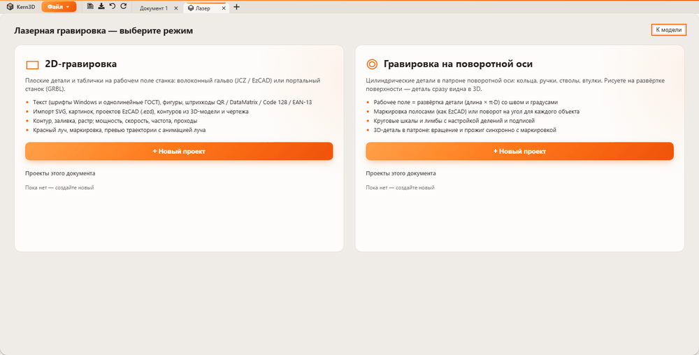
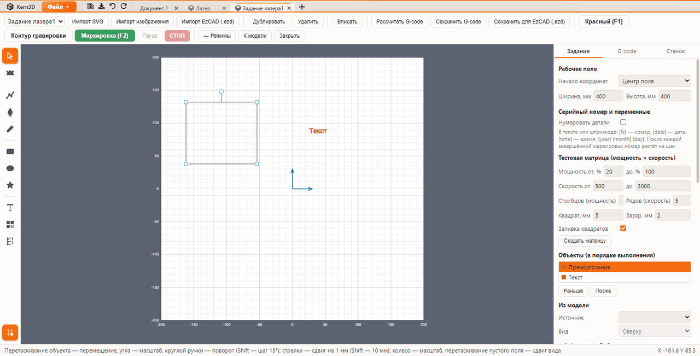
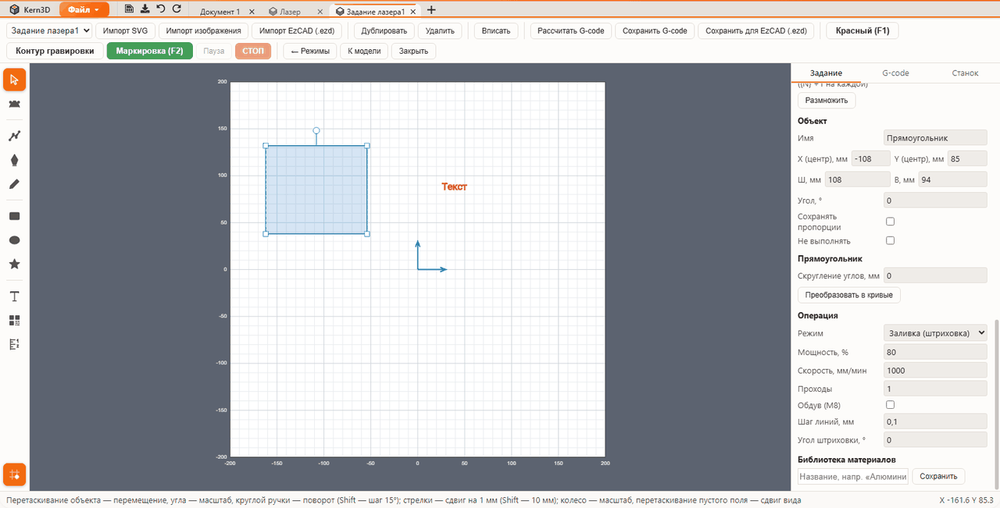
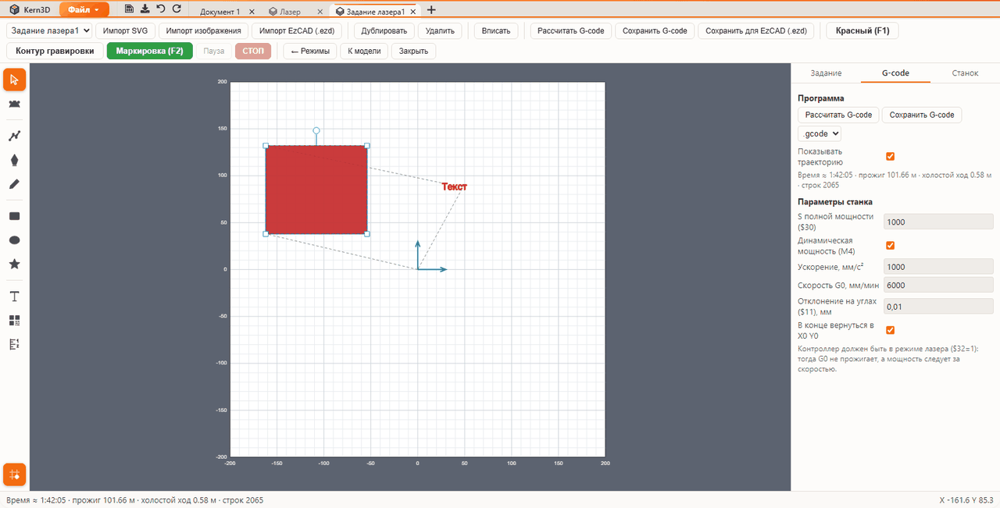
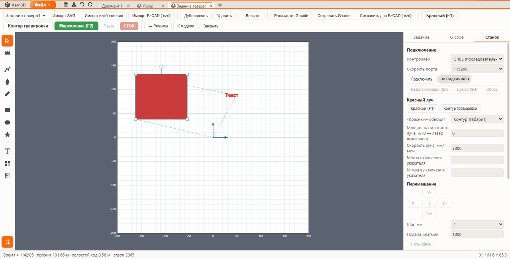

# Лазер: плоская гравировка и резка

Пространство **«Лазер»** — отдельный редактор задания для лазерного станка: рабочее поле, импорт SVG, картинок, проектов EzCAD и контуров из 3D-модели, рисование текста, фигур и штрихкодов, режимы «Линия», «Заливка» и «Растр», расчёт и сохранение G-code, подключение станка прямо из браузера и маркировка. Поддерживаются портальные станки на **GRBL** (диодные и CO₂, по последовательному порту) и волоконные гальво-станки с платой **JCZ / EzCAD** (по USB). На этой странице — плоская гравировка («2D-гравировка»). Гравировка по кругу детали в патроне описана отдельно: [Гравировка на поворотной оси](11-laser-rotary.md).

## Содержание

1. [Что умеет и какие станки](#1-что-умеет-и-какие-станки)
2. [Начало работы: страница «Лазер» и задания](#2-начало-работы-страница-лазер-и-задания)
3. [Окно редактора](#3-окно-редактора)
4. [Рабочее поле и начало координат](#4-рабочее-поле-и-начало-координат)
5. [Импорт: SVG, картинки, EzCAD, из модели](#5-импорт-svg-картинки-ezcad-из-модели)
6. [Инструменты рисования](#6-инструменты-рисования)
7. [Выбор, перемещение, масштаб, поворот](#7-выбор-перемещение-масштаб-поворот)
8. [Операция: линия, заливка, растр](#8-операция-линия-заливка-растр)
9. [Порядок выполнения](#9-порядок-выполнения)
10. [Библиотека материалов и тестовая матрица](#10-библиотека-материалов-и-тестовая-матрица)
11. [Серийный номер и переменные](#11-серийный-номер-и-переменные)
12. [Расчёт, предпросмотр и сохранение G-code](#12-расчёт-предпросмотр-и-сохранение-g-code)
13. [Подключение станка](#13-подключение-станка)
14. [Красный луч и обводка (framing)](#14-красный-луч-и-обводка-framing)
15. [Маркировка: запуск, пауза, стоп](#15-маркировка-запуск-пауза-стоп)
16. [Ручное управление: перемещение, ноль, консоль](#16-ручное-управление-перемещение-ноль-консоль)
17. [Безопасность](#17-безопасность)
18. [Горячие клавиши](#18-горячие-клавиши)
19. [Проблемы и решения](#19-проблемы-и-решения)

---

## 1. Что умеет и какие станки

| | GRBL (портальный станок) | JCZ / EzCAD (волоконный гальво) |
|---|---|---|
| Какие станки | Диодные и CO₂-гравёры с контроллером GRBL 1.1 | Волоконные маркеры с платой JCZ (LMC), которые обычно работают из EzCAD 2 |
| Как подключается | Последовательный порт (USB-COM) через Web Serial | USB через WebUSB, драйвер WinUSB |
| Что отправляется | G-code | Задание напрямую в плату (G-code не нужен) |
| Скорость в полях | мм/мин | мм/с (как в EzCAD) |
| Частота импульсов | нет | есть, кГц |

Что можно сделать без станка: подготовить задание, посмотреть траекторию и время, **сохранить G-code** в файл или **сохранить проект для EzCAD (.ezd)** и открыть его на компьютере у станка.

Задания хранятся **в документе Kern3D** вместе с моделью (картинки — внутри задания) и сохраняются вместе с ним (**Файл ▾ → Сохранить документ**, см. [Файлы и проекты](02-files-and-projects.md)). А вот **настройки станка** (поле, контроллер, мощность, скорость порта, настройки платы) и **библиотека материалов** хранятся в этом браузере / на этом компьютере и одинаковы для всех заданий.

## 2. Начало работы: страница «Лазер» и задания

### 2.1. Как открыть пространство «Лазер»

1. Откройте или создайте документ (без открытого документа пространство не открывается).
2. В переключателе пространств слева на панели команд выберите **«Лазер»**.
3. Откроется страница **«Лазерная гравировка — выберите режим»** с двумя карточками:
   - **«2D-гравировка»** — плоские детали и таблички на рабочем поле станка (эта страница руководства);
   - **«Гравировка на поворотной оси»** — цилиндрические детали в патроне ([отдельная страница](11-laser-rotary.md)).

На карточке: что умеет режим, кнопка **«+ Новый проект»** и список **«Проекты этого документа»** (до шести последних). Если проектов нет — «Пока нет — создайте новый».

- Щелчок по имени проекта — открыть его.
- **✎** («Переименовать проект») — спросит «Новое имя проекта».
- **✕** («Удалить проект») — спросит «Удалить проект «…»? Вернуть можно отменой (Ctrl+Z).»
- Кнопка **«К модели»** вверху — вернуться к 3D-модели.

### 2.2. Вкладка ленты «Лазер»

В пространстве «Лазер» на ленте есть вкладка **«Лазер»** с группой **«Задание»**:

| Кнопка | Что делает |
|---|---|
| **«2D-гравировка»** | Открывает плоское задание документа: последнее открытое или изменённое, иначе последнее созданное, а если их нет — создаёт новое «Задание лазера» |
| **«Гравировка на оси»** | То же для задания на поворотной оси ([см. страницу 11](11-laser-rotary.md)) |

Обе команды можно найти и поиском команд по названию.

### 2.3. Несколько заданий в документе

В одном документе может быть сколько угодно заданий (например, «табличка» и «шильдик»). Новое задание получает имя «Задание лазера» (с номером, если такое уже есть). Открытое задание показывается **вкладкой с его именем** в верхней строке, справа от вкладок документов; крестик на вкладке закрывает редактор задания (само задание остаётся в документе).

Внутри редактора слева на панели инструментов есть **список заданий** документа (того же режима): выберите другое — оно откроется, пункт **«+ Новый проект»** создаёт новое.

## 3. Окно редактора

- **Верхняя панель** (слева направо):
  - список заданий;
  - **«Импорт SVG»**, **«Импорт изображения»**, **«Импорт EzCAD (.ezd)»**;
  - **«Дублировать»**, **«Удалить»**;
  - **«Вписать»** — показать всё поле;
  - **«Рассчитать G-code»**, **«Сохранить G-code»** (только для GRBL; для платы JCZ эти кнопки скрыты);
  - **«Сохранить для EzCAD (.ezd)»**;
  - крупные кнопки станка: **«Красный (F1)»**, **«Контур гравировки»**, **«Маркировка (F2)»**, затем **«Пауза»** и **«СТОП»**;
  - **«← Режимы»** — назад на страницу выбора режима, **«К модели»** — к 3D-модели (задание остаётся открытым во вкладке), **«Закрыть»** — закрыть редактор задания.
- **Слева** — столбик инструментов рисования ([раздел 6](#6-инструменты-рисования)), внизу — кнопка **«Сетка 1 мм»**.
- **В центре** — рабочее поле.
- **Справа** — боковая панель с тремя вкладками:
  - **«Задание»** — поле, объекты, их размеры и операция, материалы, партия, номера;
  - **«G-code»** (для платы JCZ называется **«Расчёт»**) — расчёт, траектория, время, параметры станка;
  - **«Станок»** — подключение, красный луч, перемещение, выполнение, консоль.
- **Строка состояния** внизу: слева подсказка текущего инструмента или итог расчёта, справа — координаты курсора «X … Y …» в мм.

Все правки задания отменяются обычными **Ctrl+Z** / **Ctrl+Y** (или **Ctrl+Shift+Z**).

## 4. Рабочее поле и начало координат

**Вкладка «Задание» → «Рабочее поле».**

| Поле | Что означает | По умолчанию |
|---|---|---|
| **Начало координат** | **«Центр поля»** — X0 Y0 в середине (как у гальво и в EzCAD), координаты от −Ш/2 до +Ш/2. **«Левый нижний угол»** — X0 Y0 в левом нижнем углу (обычный «дом» портального GRBL-станка) | Центр поля |
| **Ширина, мм** / **Высота, мм** | Размер рабочего поля станка | 400 × 400 |

- На поле: сетка через 10 мм (через 50 мм — темнее), цифры каждые 50 мм по нижнему и левому краю, синие стрелки X/Y в начале координат.
- Смена начала координат **не сдвигает объекты на поле** — меняются только их координаты.
- Для портального станка на GRBL обычно выбирают **«Левый нижний угол»**: тогда X0 Y0 задания совпадает с нулём станка.
- Для гальво-станка поставьте размер поля равным полю линзы (например, 150 × 150 при поле линзы 150 мм) — поле линзы задаётся отдельно на вкладке «Станок» ([раздел 13.4](#134-плата-jcz--ezcad-по-usb)).
- Если задание выходит за поле, при расчёте появится «Задание выходит за рабочее поле: перемещения обрезаются по его краю» (у платы JCZ — «Часть задания за пределами поля линзы: она обрезана по краю поля»).

Размер поля и начало координат — настройки станка: они запоминаются в браузере и действуют во всех заданиях.

## 5. Импорт: SVG, картинки, EzCAD, из модели

Новый объект ставится в начало координат (при «Центр поля» — по центру поля), выделяется, и его можно сразу двигать.

### 5.1. Импорт SVG

**Верхняя панель → «Импорт SVG»**, выберите один или несколько файлов `.svg`.

- Берутся контуры: пути, линии, ломаные, многоугольники, прямоугольники (в том числе скруглённые), круги и эллипсы — с учётом всех трансформаций групп и `use`.
- Размер — настоящий: по `width`/`height` и `viewBox` файла; единицы без размерности считаются пикселями CSS (96 точек на дюйм).
- **Текст, встроенные картинки и скрытые элементы не импортируются.** Текст переведите в кривые в своей программе (в Inkscape: «Контур → Оконтурить объект»), картинки импортируйте отдельно.
- Новый объект получает режим **«Линия (по контуру)»**, пропорции заблокированы.
- Если контуров нет — «Не найдено контуров для гравировки».

### 5.2. Импорт изображения (картинки, фото)

**Верхняя панель → «Импорт изображения»** — PNG, JPEG или BMP.

- Размер на поле считается из расчёта 10 пикселей на мм; слишком большая картинка уменьшается до 90 % поля.
- Объект получает режим **«Изображение (растр)»** ([раздел 8.3](#83-изображение-растр-режимы-гравировки)).
- Прозрачные участки считаются белыми (не прожигаются).
- Картинка хранится внутри задания (в документе).
- Не открылась — «Не удалось прочитать изображение».

### 5.3. Импорт EzCAD (.ezd)

**Верхняя панель → «Импорт EzCAD (.ezd)»** — проект EzCAD 2 вместе с параметрами перьев: мощностью, скоростью, проходами, частотой и штриховкой.

- Каждый объект верхнего уровня (группа — целиком) становится объектом задания; координаты считаются от центра поля, как в EzCAD.
- Все импортированные объекты выделяются, вид вписывается.
- В строке состояния: «Из EzCAD взято объектов: N (файл)». Если что-то не перенесено, появится сообщение «EzCAD: …» со списком, например:
  - «поворот штриховки по проходам не перенесён», «взята только первая штриховка», «перекрёстная штриховка — одним углом»;
  - «текст без контуров — пустая заготовка»;
  - «в группе разные перья — взято одно»;
  - «картинка внутри группы пропущена», «отражение картинки не перенесено»;
  - «объекты управления (вход/выход, таймер, ось) пропущены»;
  - «неподдерживаемые объекты пропущены», «часть файла не прочитана».
- Не EzCAD-файл — «Это не файл EzCAD (.ezd)».

### 5.4. Из модели: тело, чертёж, грань

**Вкладка «Задание» → «Из модели».**

| Поле / кнопка | Что делает |
|---|---|
| **Источник** | Тело или чертёж документа (чертежи подписаны «Чертёж: имя») |
| **Вид** | **«Сверху»**, **«Спереди»**, **«Справа»** — с какой стороны взять контур тела (только для тел) |
| **«Добавить»** | Добавляет видимые линии тела с выбранной стороны в масштабе 1:1 (невидимые линии не берутся); для чертежа — весь лист со всем, что на нём, в натуральную величину |
| **«Выбрать грань…»** | Переключает на модель: щёлкните плоскую грань — её контур с отверстиями, если смотреть на неё прямо, вернётся в задание объектом «Тело: грань» |

Так удобно делать шильдик по контуру детали или вырезать прокладку по грани. О чертежах — [Чертежи](09-drawings.md).

### 5.5. DXF и другие форматы

Редактор лазера открывает только **SVG**, картинки (PNG, JPEG, BMP) и **.ezd**. DXF сначала переведите в SVG в другой программе (например, в Inkscape) или постройте деталь в Kern3D и возьмите контур «Из модели».

## 6. Инструменты рисования

Столбик слева. У каждого инструмента — клавиша (буква в названии). Наведите на кнопку — появится подсказка.

- Обычный щелчок по кнопке — инструмент работает на одну фигуру, потом снова «Выбор».
- **Двойной щелчок по кнопке** — инструмент остаётся включённым для фигуры за фигурой.
- **Esc** — отменить рисуемую фигуру, второй раз — вернуться к «Выбору».
- **«Сетка 1 мм»** (внизу столбика) — точки ложатся на сетку 1 мм. **Alt** — временно без сетки.

| Кнопка | Клавиша | Что делает |
|---|---|---|
| **«Выбор (V)»** | V | Выбор, перемещение, масштаб и поворот объектов |
| **«Узлы (N)»** | N | Правка узлов и ручек кривой ([6.6](#66-узлы-правка-кривых)) |
| **«Линия (L)»** | L | Ломаная по щелчкам |
| **«Кривая (C)»** | C | Перо: кривые Безье |
| **«Карандаш (F)»** | F | Рисование от руки |
| **«Прямоугольник (R)»** | R | Прямоугольник, Shift — квадрат |
| **«Эллипс (E)»** | E | Эллипс, Shift — круг |
| **«Многоугольник (P)»** | P | Многоугольник или звезда от центра |
| **«Текст (T)»** | T | Текст |
| **«Штрихкод (B)»** | B | QR, DataMatrix, Code 128, EAN-13 |
| **«Шкала»** | K | Линейка с делениями |

Нарисованная фигура остаётся **параметрической**: её размеры, текст, шрифт, число вершин и т. п. правятся в разделе свойств объекта на вкладке «Задание».

### 6.1. Линия, Кривая, Карандаш

**«Линия (L)»**

1. Щелчками ставьте точки. **Shift** — направление с шагом 15°.
2. Закончить: **двойной щелчок** или **Enter**. Щелчок по первой точке **замыкает** контур.
3. **Esc** — отмена.

В свойствах: **«Замкнуть»** (галочка; нужно хотя бы 3 точки).

**«Кривая (C)»** (перо, как в графических редакторах)

- Щелчок — угловой узел; щелчок с протяжкой — гладкий узел с ручками; **Alt** при протяжке — излом (ручки порознь).
- Двойной щелчок или **Enter** — конец; щелчок по первому узлу — замкнуть.

**«Карандаш (F)»** — рисуйте с нажатой кнопкой мыши; линия упрощается и сглаживается в кривые. Если закончить у начала — получится замкнутый контур.

### 6.2. Прямоугольник, Эллипс, Многоугольник

- **«Прямоугольник (R)»** — протяните рамку; **Shift** — квадрат, **Alt** — без сетки. В свойствах: **«Скругление углов, мм»**.
- **«Эллипс (E)»** — протяните рамку эллипса; **Shift** — круг.
- **«Многоугольник (P)»** — протяните от центра к вершине; **Shift** — поворот шагом 15°. В свойствах:
  - **«Вершин»** — от 3 до 200 (по умолчанию 6);
  - **«Звезда: внутренний радиус, % (0 — без)»** — 0…99; больше нуля — получается звезда.
  - Последние значения запоминаются для следующего многоугольника.

Размеры (Ш, В) прямоугольника и эллипса меняются в общих полях объекта ([7.2](#72-свойства-объекта-точные-размеры-и-положение)); скругление при этом остаётся круглым.

### 6.3. Текст и шрифты

1. **«Текст (T)»** → щёлкните, где начинается текст.
2. Появится «Текст», а справа — поле ввода с выделенным словом: просто начните печатать. Многострочный текст — через Enter.

Пока грузится шрифт — «Загружаю шрифт…». Нет сети / шрифт не найден — «Шрифт недоступен: нет сети или шрифт не найден».

Свойства текста:

| Поле | Что означает |
|---|---|
| (поле текста) | Сам текст; можно вставлять переменные `{N}`, `{date}`… ([раздел 11](#11-серийный-номер-и-переменные)) |
| **Шрифт** | Список шрифтов по группам (см. ниже) |
| **Размер шрифта, мм** | Высота шрифта; по умолчанию 10 |
| **Между буквами, мм** | Добавочный интервал между буквами |
| **Междустрочный** | Множитель межстрочного интервала, по умолчанию 1,2 |
| **Выравнивание** | «Влево», «По центру», «Вправо» |
| **По дуге: радиус, мм (+ сверху, − снизу, 0 — прямо)** | Текст по окружности: плюс — дуга выпуклостью вверх, минус — вниз |
| **Штриховка текста** → **«Заштриховать буквы»** | Заливка букв штриховкой (то же, что режим «Заливка»); появятся «Шаг линий, мм», «Угол штриховки, °» и **«Обвести контур после штриховки»** |

Группы шрифтов в списке:

- **«Однолинейные (гравировка)»** — ГОСТ тип Б, ГОСТ тип А, Hershey Sans, Hershey Sans Bold, Hershey Serif, Hershey Script, Hershey Gothic, Relief SingleLine. Буква — одна линия, а не контур: быстро и чётко на металле. Кириллица есть в ГОСТ А/Б и Hershey Serif; в остальных русские буквы берутся из похожего шрифта. Однолинейный текст **нельзя заштриховать** («Однолинейный шрифт: буква — одна линия, штриховать нечего. Для штриховки выберите обычный шрифт.»), режим у него только «Линия».
- **«Стандартные»** и **«Установленные»** — шрифты Windows (в программе Kern3D для компьютера).
- В Chrome и Edge в конце списка есть пункт **«Шрифты компьютера…»** — браузер один раз спросит разрешение и покажет установленные шрифты.
- **«Из интернета»** — открытые шрифты из каталога Kern3D (загружаются при первом выборе, нужна сеть). По умолчанию в браузере — Roboto, в программе для компьютера — Arial.

### 6.4. Штрихкод: QR, DataMatrix, Code 128, EAN-13

1. **«Штрихкод (B)»** → щёлкните, где поставить код.
2. Появится QR-код с текстом «Kern3D»; данные введите в поле справа.

| Поле | Что означает |
|---|---|
| **Тип кода** | «QR-код», «DataMatrix», «Code 128», «EAN-13» |
| (поле данных) | Что закодировать; можно с переменными `{N}`, `{date}`… |
| **Коррекция ошибок** (только QR) | «L — 7 %», «M — 15 %» (по умолчанию), «Q — 25 %», «H — 30 %» |
| **Модуль, мм** | Размер одной клетки / самого тонкого штриха; по умолчанию 0,5 |
| **Поле, модулей** | Чистое поле вокруг кода |
| **Высота штрихов, мм** (Code 128, EAN-13) | По умолчанию 15 |
| **Цифры под кодом** (Code 128, EAN-13) | Подписать код цифрами |
| **Инверсия (выжигать фон)** | Выжигается фон, а модули остаются светлыми — для тёмного металла |

Ошибки данных (изменение отменяется):

- «Данные не помещаются в код этого типа»;
- «EAN-13: нужно 12 цифр (или 13 с верной контрольной)»;
- «Code 128: только латиница, цифры и знаки ASCII»;
- «Код с такими данными не построить».

Чтобы код читался сканером, заливайте его плотно: режим **«Заливка»** с маленьким «Шагом линий» (например 0,05 мм на металле).

### 6.5. Шкала (линейка)

**«Шкала»** (клавиша **K**) → щелчок по полю. На плоском задании получается **линейка 100 мм** с делениями через 1 мм, крупными через 10 и средними через 5, с цифрами шрифтом ГОСТ тип Б. Шкала всегда в режиме «Линия». Круговые шкалы и лимбы — на [поворотной оси](11-laser-rotary.md).

Свойства:

- **«Шкала: диапазон»**: «Длина шкалы, мм», «От», «До», «Шаг деления», «Крупное каждое», «Среднее каждое», «Обратный отсчёт», «Без последнего деления (0 = 360)».
- **«Деления»**: «Толщина линии, мм (0 — один проход)», «Шаг проходов, мм» (для толстой линии), «Длина крупного, мм», «Длина среднего, мм», «Длина мелкого, мм», «Деления в другую сторону», «Линия вдоль шкалы».
- **«Подписи»**: «Подписывать», «Каждое N-е крупное», «Высота цифр, мм», «Отступ от деления, мм», «После числа» (например «мм»), «Знаков после запятой», «Цифры вдоль шкалы», «Шрифт» (однолинейные).

### 6.6. Узлы: правка кривых

Включить: **«Узлы (N)»**, кнопка **«Править узлы (N)»** в свойствах объекта или **двойной щелчок** по объекту.

- Тяните узлы и ручки; **Alt** — ручки порознь.
- Щелчок по контуру — новый узел.
- **Delete** — удалить узел. **Esc** или двойной щелчок по пустому месту — выход.
- Квадрат — угловой узел, круг — гладкий.

Кнопки в разделе **«Узлы»** справа (для выбранного узла):

| Кнопка | Что делает |
|---|---|
| **«Угол / гладкий»** | Переключает узел угловой ↔ гладкий |
| **«Разорвать»** | Размыкает или делит кривую в узле |
| **«Соединить»** | Соединяет конечный узел с ближайшим концом другой кривой (или замыкает) |
| **«Замкнуть / разомкнуть»** | Замыкает или размыкает кривую |
| **«Удалить узел»** | Удаляет выбранный узел (Delete) |

Сообщения: «Выберите один векторный объект», «Сначала «Преобразовать в кривые» в свойствах объекта» (у прямоугольника, текста и т. п. узлов нет, пока это фигура), «Сначала выберите узел», «Соединяются только концы незамкнутой кривой».

### 6.7. Преобразовать в кривые

Кнопка **«Преобразовать в кривые»** в свойствах фигуры делает её обычными контурами. После этого правятся узлы, но параметры фигуры (текст, шрифт, скругление, данные кода) больше не меняются. Переменные `{N}` в таком объекте тоже перестают обновляться.

## 7. Выбор, перемещение, масштаб, поворот

### 7.1. Мышь и клавиши

Подсказка в строке состояния: «Перетаскивание объекта — перемещение, угла — масштаб, круглой ручки — поворот (Shift — шаг 15°); стрелки — сдвиг на 1 мм (Shift — 10 мм); колесо — масштаб, перетаскивание пустого поля — сдвиг вида».

| Действие | Как |
|---|---|
| Выбрать | Щелчок по объекту (или по строке в списке «Объекты») |
| Добавить / убрать из выделения | **Shift** или **Ctrl** + щелчок |
| Выбрать рамкой | Протянуть левой кнопкой по пустому полю — выделится всё, что целиком внутри |
| Выбрать всё | **Ctrl+A** |
| Переместить | Перетащить объект; **стрелки** — на 1 мм, **Shift+стрелки** — на 10 мм |
| Масштаб | Тянуть за угол рамки (при «Сохранять пропорции» — без искажения; группа всегда масштабируется пропорционально) |
| Повернуть | Тянуть круглую ручку; **Shift** — шаг 15° |
| Сдвиг вида | Перетаскивание **средней или правой** кнопкой мыши |
| Масштаб вида | Колесо мыши; **«Вписать»** — всё поле целиком |
| Снять выделение | **Esc** |

Несколько выделенных объектов двигаются, масштабируются и поворачиваются вместе — общей рамкой.

### 7.2. Свойства объекта (точные размеры и положение)

**Вкладка «Задание» → «Объект»** (виден, когда выбран один объект).

| Поле | Что означает |
|---|---|
| **Имя** | Имя в списке объектов |
| **X (центр), мм** / **Y (центр), мм** | Положение центра объекта (0, 0 — в начале координат), как в EzCAD |
| **Ш, мм** / **В, мм** | Ширина и высота; объект растёт от центра |
| **Угол, °** | Поворот против часовой стрелки |
| **Сохранять пропорции** | При вводе Ш высота меняется сама (и наоборот) |
| **Не выполнять** | Объект остаётся в задании, но не гравируется и не попадает в G-code (в списке — зачёркнут) |

Числа: запятая читается как точка; **↑/↓** в поле — шаг (с Shift — ×10), колесо мыши над полем в фокусе — тоже шаг. Значение применяется по Enter или при уходе из поля.

### 7.3. Выравнивание и распределение

**Вкладка «Задание» → «Выравнивание»** (когда что-то выбрано). Подпись: «Выбрано объектов: N (Shift/Ctrl+щелчок, рамка, Ctrl+A)».

- **«⇤ Влево»**, **«↔ По центру»**, **«⇥ Вправо»**, **«⤒ Вверх»**, **«↕ По середине»**, **«⤓ Вниз»** — выровнять края или середины.
- Один объект выравнивается **по полю** (например, «↔ По центру» + «↕ По середине» — точно в центр поля). Несколько — по их общей рамке; галочка **«Относительно поля»** — по полю.
- **«Распределить по горизонтали»** / **«Распределить по вертикали»** — равные промежутки (от трёх объектов).

### 7.4. Дублировать, Удалить, Партия

- **«Дублировать»** (Ctrl+D) — копия выделенного со сдвигом на 5 мм.
- **«Удалить»** (Delete) — удалить выделенное.
- **«Партия (размножить сеткой)»** — раздел на вкладке «Задание», когда что-то выбрано. Размножает выделенное сеткой — лист бирок, оснастка с деталями:

| Поле | Что означает | По умолчанию |
|---|---|---|
| **Столбцов** / **Рядов** | Размер сетки (1–100); копии идут вправо по столбцам, вниз по рядам | 3 / 2 |
| **Зазор X, мм** / **Зазор Y, мм** | Промежуток между копиями (шаг = размер выделенного + зазор) | 5 / 5 |
| **Нумеровать копии ({N} +1 на каждой)** | У каждой копии `{N}` на шаг больше; серийный номер включается сам | вкл. |

Кнопка **«Размножить»**.

## 8. Операция: линия, заливка, растр

**Вкладка «Задание» → «Операция»** — у каждого объекта свои режим и параметры (своё «перо»). Цвет метки в списке объектов: красный — линия, синий — заливка, серый — изображение.

### 8.1. Режим и общие поля (мощность, скорость, проходы, частота)

| Поле | Что означает | По умолчанию |
|---|---|---|
| **Режим** | **«Линия (по контуру)»** — луч идёт по контурам (резка, обводка). **«Заливка (штриховка)»** — замкнутые контуры заполняются параллельными линиями. **«Изображение (растр)»** — только для картинок | Линия — для SVG и линий; для картинок — Изображение |
| **Мощность, %** | Доля полной мощности (0–100). Для GRBL 100 % = значение «S полной мощности ($30)» | 80 (линия), 50 (заливка, растр) |
| **Частота, кГц** | Только для платы JCZ: частота импульсов волоконного источника; пределы берутся из настроек EzCAD (по умолчанию 20–100) | 50 |
| **Скорость, мм/мин** (GRBL) / **Скорость, мм/с** (JCZ) | Скорость рабочего хода | GRBL: 1000 мм/мин (растр 3000); JCZ: новые объекты 300 мм/с |
| **Проходы** | Сколько раз повторить объект (целое ≥ 1) | 1 |
| **Обдув (M8)** | Для GRBL: перед объектом M8 (включить обдув), после — M9. На плате JCZ не используется | выкл. |

### 8.2. Заливка (штриховка)

При режиме **«Заливка (штриховка)»** появляются:

| Поле | Что означает | По умолчанию |
|---|---|---|
| **Шаг линий, мм** | Расстояние между линиями штриховки (от 0,01) | 0,1 |
| **Угол штриховки, °** | Направление линий от оси X | 0 |

- Отверстия внутри контура остаются пустыми (буква «О» не заливается в середине).
- Линии идут «змейкой» (через одну в обратную сторону) — меньше холостых ходов.
- Для текста есть ещё **«Обвести контур после штриховки»** — чистый край после заливки, как «обвести контур» в EzCAD.
- Незамкнутые линии при заливке замыкаются.

### 8.3. Изображение (растр): режимы гравировки

Для картинок. Гравируется построчно, снизу вверх, змейкой.

| Поле | Что означает | По умолчанию |
|---|---|---|
| **Гравировка** | **«Линия за линией (оттенки)»** — мощность зависит от темноты пикселя (фото на дереве, коже). **«Дизеринг»** — точки «есть / нет», полутон рисуется плотностью точек (фото на металле, анодировании). **«Порог»** — чёрно-белое: темнее порога жжётся, светлее — нет (логотипы, надписи) | Линия за линией |
| **Алгоритм** (дизеринг) | «Флойд — Стейнберг» или «Джарвис — Джудис — Нинке» (мягче, меньше «червячков») | Флойд — Стейнберг |
| **Разрешение, линий/мм** | Строк и точек на мм (0,5–40). 10 линий/мм = шаг 0,1 мм | 10 |
| **Яркость** | −100…100 | 0 |
| **Контраст** | −100…100 | 0 |
| **Гамма** | 0,1–5; больше 1 — темнее средние тона | 1 |
| **Инверсия** | Негатив (светлое жжётся) | выкл. |
| **Порог, %** (режим «Порог») | Пиксели темнее этой светлоты прожигаются | 50 |
| **Отсечка белого, %** («Линия за линией») | Пиксели светлее (100 − это) % не жгутся вовсе | 5 |
| **Мин. мощность, %** («Линия за линией») | Мощность самого светлого прожигаемого пикселя (самый тёмный получает «Мощность» объекта) | 0 |
| **Перебег, мм** | Насколько голова выезжает за край строки с выключенным лазером, чтобы развернуться вне изделия | 2 |

Длинные белые участки строки проходятся холостым ходом. Картинки больше 4000 пикселей по стороне при расчёте уменьшаются.

## 9. Порядок выполнения

Объекты гравируются **в порядке списка «Объекты (в порядке выполнения)»** на вкладке «Задание» — сверху вниз; каждый объект целиком (все проходы), затем следующий.

- Выберите объект и нажмите **«Раньше»** или **«Позже»**, чтобы сдвинуть его в списке.
- Совет: сначала гравировка и заливка, **резка — последней**, иначе деталь может сместиться, выпав из листа.
- Внутри объекта контуры обходятся «ближайший следующий»: после каждого контура берётся тот, чьё начало ближе к голове; замкнутый контур начинается с ближайшей вершины.

Пустой список: «Импортируйте SVG или изображение либо возьмите контур из модели».

## 10. Библиотека материалов и тестовая матрица

### 10.1. Библиотека материалов (пресеты)

**Вкладка «Задание» → «Операция» → «Библиотека материалов»** (у выбранного объекта).

- **Сохранить**: введите имя в поле «Название, напр. «Алюминий анод. — заливка»» → **«Сохранить»** (или Enter). Запоминаются мощность, скорость, частота, проходы, режим, шаг и угол штриховки, обдув. Материал с тем же именем заменяется.
- **Применить**: список **«Применить материал»** → выберите материал — параметры перейдут на выбранный объект (у картинки режим остаётся «Изображение»).
- **Удалить**: выберите материал во втором списке → **«Удалить»** → подтвердите «Удалить материал «…» из библиотеки?».

Библиотека хранится в этом браузере / на этом компьютере и общая для всех заданий и документов.

### 10.2. Тестовая матрица (мощность × скорость)

Чтобы подобрать режим для нового материала: квадраты с разной мощностью (по столбцам) и скоростью (по рядам) и подписи значений. Прожгите на образце и выберите лучший квадрат.

**Вкладка «Задание» → «Тестовая матрица (мощность × скорость)»:**

| Поле | По умолчанию |
|---|---|
| **Мощность от, %** / **до, %** | 20 / 100 |
| **Скорость от** / **до** | 500 / 3000 (мм/мин) |
| **Столбцов (мощность)** / **Рядов (скорость)** | 5 / 5 (1–20) |
| **Квадрат, мм** / **Зазор, мм** | 5 / 2 |
| **Заливка квадратов** | вкл. (иначе только контуры) |

**«Создать матрицу»** — матрица ставится в левый верхний угол поля; каждый квадрат называется «P… S…», подписи гравируются тонкой линией на самой малой мощности и самой высокой скорости, над матрицей — «P % / S».

> ⚠️ Скорости матрицы вводятся **в мм/мин даже для гальво-станка** (300 мм/с = 18 000 мм/мин). В квадратах на гальво поле «Скорость, мм/с» покажет пересчитанное значение.

## 11. Серийный номер и переменные

**Вкладка «Задание» → «Серийный номер и переменные».**

В тексте или данных штрихкода можно писать переменные:

| Переменная | Что подставляется |
|---|---|
| `{N}` | Серийный номер |
| `{date}` | Дата, дд.мм.гггг |
| `{time}` | Время, чч:мм |
| `{year}`, `{month}`, `{day}` | Год, месяц, день |

Неизвестные `{…}` остаются как есть.

| Поле | Что означает |
|---|---|
| **Нумеровать детали** | Включить серийный номер для этого задания |
| **Следующий номер** | Номер, который получит следующая маркировка |
| **Шаг** | На сколько растёт номер |
| **Знаков (с нулями)** | Дополнять нулями до N знаков (0 — как есть; до 12) |

- **После каждой завершённой маркировки** («Маркировка» на станке) номер растёт на шаг, а при партии с нумерацией — на число копий. Сохранение G-code в файл номер не меняет.
- Дата и время подставляются в момент запуска маркировки.
- Пример: текст `SN {N}`, «Знаков» 4 → «SN 0001», «SN 0002»…

## 12. Расчёт, предпросмотр и сохранение G-code

**Вкладка «G-code»** (для JCZ — **«Расчёт»**).

### 12.1. Рассчитать и посмотреть траекторию

1. **«Рассчитать G-code»** (на верхней панели или на вкладке; для JCZ — **«Рассчитать»** в разделе «Траектория и время»).
2. На поле поверх объектов появится траектория:
   - **красные** линии — прожиг (чем ярче, тем больше мощность);
   - **зелёные пунктирные** — холостые перемещения G0;
   - **серые** — ходы с выключенным лазером (перебег растра).
3. В строке состояния и на вкладке — итог: «Время ≈ … · прожиг … м · холостой ход … м · строк …» (для JCZ — без числа строк).

- Галочка **«Показывать траекторию»** прячет / показывает траекторию.
- После любой правки задания или станка расчёт сбрасывается: «Ещё не рассчитана или задание изменилось». Кнопки «Сохранить G-code» и «Маркировка» сами пересчитают задание.
- Время — оценка по ускорению и скоростям из «Параметров станка».

**Анимация луча.** Во время маркировки на станке по траектории идёт яркая точка луча, а пройденный путь подсвечивается; в строке состояния — «Маркировка: N % · осталось ≈ …». Для GRBL точка следует за реальным положением головы, для JCZ — по расчётному времени.

### 12.2. Сохранить G-code (GRBL)

**«Сохранить G-code»** — файл с именем задания; расширение выбирается рядом: **.gcode** или **.nc**.

Что в файле: комментарий с размером поля, `G21` (мм), `G90` (абсолютные координаты), `M4 S0` (или `M3 S0`), затем объекты по порядку (имя объекта — комментарием), обдув M8/M9 вокруг объектов, где он включён, в конце `M5` и, если включено, возврат `G0 X0 Y0`. Перемещения обрезаются по краю рабочего поля.

Такой файл можно отправить в станок и другими программами (LaserGRBL, UGS, Candle и т. п.) — они должны держать контроллер в режиме лазера `$32=1`.

### 12.3. Параметры станка (GRBL)

На вкладке «G-code», раздел **«Параметры станка»**:

| Поле | Что означает | По умолчанию |
|---|---|---|
| **S полной мощности ($30)** | Значение S, соответствующее 100 %; должно совпадать с `$30` контроллера | 1000 |
| **Динамическая мощность (M4)** | M4 — мощность следует за скоростью (на разгонах и углах не пережигает); выкл. — M3, постоянная мощность | вкл. |
| **Ускорение, мм/с²** | Для оценки времени (`$120`/`$121`) | 1000 |
| **Скорость G0, мм/мин** | Холостой ход (`$110`/`$111`), для оценки времени | 6000 |
| **Отклонение на углах ($11), мм** | Для оценки времени | 0,01 |
| **В конце вернуться в X0 Y0** | В конце задания голова едет в ноль | вкл. |

Подсказка: «Контроллер должен быть в режиме лазера ($32=1): тогда G0 не прожигает, а мощность следует за скоростью.»

### 12.4. Сохранить для EzCAD (.ezd)

**Верхняя панель → «Сохранить для EzCAD (.ezd)»** — проект EzCAD 2 (для любого контроллера): контуры — кривыми, заливка — штриховкой, каждый набор параметров — своим пером (мощность, скорость, частота, проходы). Файл называется по имени задания.

Строка состояния: «Для EzCAD сохранено объектов: N (файл)». Что не перенесено:

- «картинки не сохранены» — растровые изображения в .ezd не пишутся;
- «скрытые объекты не сохранены» — объекты с «Не выполнять»;
- «режимов больше 256 — лишние на последнем пере»;
- «длительность импульса (MOPA) не перенесена».

## 13. Подключение станка

**Вкладка «Станок» → «Подключение».**

### 13.1. Где это работает

- **Chrome или Edge на компьютере** — да: GRBL через Web Serial, плата JCZ через WebUSB.
- **Программа Kern3D для компьютера** (Windows) — да, плюс переключение драйвера платы JCZ одной кнопкой. См. [Телефон и программа для компьютера](15-phone-and-desktop.md).
- **Firefox и Safari** — нет: станок не подключится, но задание можно подготовить и сохранить G-code / .ezd.
- **Телефон и планшет** — только смотреть модели и проекты.

На стартовом экране Kern3D (щелчок по логотипу) показано, где запущена программа; если станки подключать можно — рядом надпись **«Станки по USB: доступны»**. Иначе — совет «В этом браузере станки по USB не подключаются. Откройте Kern3D в Chrome или Edge или в программе Kern3D.» (на телефоне — «На телефоне можно смотреть модели и проекты. Станки подключайте с компьютера: Chrome, Edge или программа Kern3D.»). Совет закрывается кнопкой **«Понятно»**.

### 13.2. Контроллер

Поле **«Контроллер»**:

- **«GRBL (последовательный порт)»**;
- **«JCZ / EzCAD (волоконный, USB)»**.

При смене контроллера подключённый станок отключается (лазер выключается), панель перестраивается. Для JCZ на вкладке «G-code» вместо G-code — «Расчёт», скорости — в мм/с, появляется «Частота, кГц».

### 13.3. GRBL по последовательному порту

1. Подключите станок кабелем USB и включите его.
2. **«Скорость порта»** — 9600, 57600, **115200** (по умолчанию, обычная для GRBL), 230400 или 250000.
3. **«Подключить»** → браузер покажет свой список портов → выберите порт станка (обычно «USB-SERIAL CH340» или похожий) → «Подключиться».
4. В консоли — «Порт открыт», значок рядом с кнопкой показывает состояние GRBL (Idle, Run, Hold, Alarm…). Ниже — «Рабочие: X… Y… · машинные: X… Y… · F … · S …».
5. Если станок в аварии (Alarm) — **«Разблокировать ($X)»** или **«Домой ($H)»**.

Кнопки (активны, когда станок подключён и задание не идёт):

| Кнопка | Что делает |
|---|---|
| **«Разблокировать ($X)»** | Снимает аварию без поиска нуля; затем проверьте положение головы |
| **«Домой ($H)»** | Поиск нуля по концевикам: нужны концевики и `$22=1` |
| **«Сброс»** | Программный сброс контроллера (Ctrl-X) |
| **«Отключить»** | Выключает лазер и закрывает порт («Порт закрыт») |

Если браузер не умеет Web Serial: «Этот браузер не умеет открывать последовательные порты (Web Serial). Используйте Chrome или Edge либо программу Kern3D для компьютера; G-code по-прежнему можно сохранить в файл.»

### 13.4. Плата JCZ / EzCAD по USB

Плата JCZ (LMC, USB VID 9588, PID 9899) из Kern3D открывается **только через драйвер WinUSB**. Драйвер EzCAD (Lmcv4u) её не отдаёт, а пока плату держит Kern3D, её не видит EzCAD.

**В программе Kern3D для компьютера (Windows):**

- Строка **«Драйвер платы»**: «Kern3D (WinUSB)», «EzCAD (Lmcv4u)», «другой драйвер», «без драйвера», «плата не подключена» или «только в Windows».
- Кнопка **«Переключить на Kern3D»** — ставит плате WinUSB; Windows попросит права администратора («переключаю… подтвердите права в окне Windows»). Готово — «Плата переключена на Kern3D (WinUSB)».
- Кнопка **«Вернуть EzCAD»** — возвращает драйвер EzCAD; готово — «Плата возвращена EzCAD».
- При **«Подключить»** плата на драйвере EzCAD переключается сама: «Плата на драйвере EzCAD: переключаю на Kern3D».
- Отказ в окне Windows — «Переключение драйвера отменено»; ошибка — «Не удалось переключить драйвер платы».

**В Chrome / Edge:** подсказка «Плата JCZ подключается по USB через драйвер WinUSB. Драйвер EzCAD (Lmcv4u) её не отдаёт: один раз поставьте WinUSB через Zadig, вернуть драйвер EzCAD можно в «Диспетчере устройств».»

Подключение:

1. **«Подключить»** → в окне браузера выберите плату.
2. В консоли — «Плата JCZ: серийный …, версия …»; состояние — «Готова», «Выполняет», «Красный луч» или «Пауза».

Сообщения при ошибке:

- «WebUSB недоступен в этом браузере»;
- «Плата не найдена. Если её держит драйвер EzCAD, поставьте WinUSB через Zadig (USB\VID_9588&PID_9899)»;
- «Плата занята: закройте EzCAD и подключите снова».

**Раздел «Плата JCZ (EzCAD)»:**

| Поле / кнопка | Что означает | По умолчанию |
|---|---|---|
| **«Импорт настроек EzCAD»** | Выберите файл `plug\markcfg7` (поле, смещение, гальво, лазер) и, если нужно, `PARAM\MarkParam.lib` (перья) из папки EzCAD. Результат: «Из EzCAD взято значений: N» | — |
| **Поле линзы, мм** | Размер поля линзы (1–1000) | 150 |
| **Смещение поля X / Y, мм** | Сдвиг центра поля | 0 / 0 |
| **Поворот поля, °** | Поворот поля | 0 |
| **Поменять оси X и Y** | Если гравировка идёт повёрнутой на 90° / зеркально | вкл. |
| **Сдвиг красного луча X / Y, мм** | Совместить красный указатель с реальным местом прожига | 0 / 0 |

Лучше всего один раз импортировать `markcfg7` из EzCAD этого станка — тогда поле, гальво и пределы частоты совпадут с EzCAD. Сообщения импорта: «В файле … не нашлось настроек EzCAD», «EzCAD использует файл коррекции …: он пока не загружается», «Прочитано, но не применено (у платы нет такой команды): …».

У гальво-головы **ноль — центр поля**; кнопка «Ноль здесь» отвечает «У гальво-головы ноль — центр поля; сдвиг задаётся смещением поля в настройках платы».

Раздел **«Поворотная ось (патрон)»** на этой вкладке относится к гравировке по кругу — см. [Гравировка на поворотной оси](11-laser-rotary.md).

Если браузер не умеет WebUSB: «Этот браузер не умеет работать с USB-устройствами (WebUSB). Используйте Chrome или Edge либо программу Kern3D для компьютера.»

## 14. Красный луч и обводка (framing)

Показывает на заготовке, где ляжет гравировка, — до прожига.

| Кнопка | Что делает |
|---|---|
| **«Красный (F1)»** | Обводит границу задания красным лучом (или лазером на пилотной мощности) по кругу, пока не нажать снова или **Esc** |
| **«Контур гравировки»** | Проходит по фактическим контурам задания (картинки — по рамке), пока не нажать снова или **Esc** |

Кнопки есть на верхней панели и на вкладке «Станок» в разделе **«Красный луч»**. Станок не подключён — «Сначала подключите станок (вкладка «Станок»)», и откроется вкладка «Станок». Нечего обводить — «Не найдено контуров для гравировки».

Настройки:

| Поле | Что означает | По умолчанию |
|---|---|---|
| **«Красный» обводит** | **«Контур (габарит)»** — прямоугольник вокруг задания; **«Обводка (внешние контуры)»** — внешние контуры объектов, упрощённые | Контур (габарит) |
| **Мощность пилотного луча, % (0 — лазер выключен)** | GRBL: с какой мощностью идти по контуру. 0 — голова ездит с выключенным лазером. Для слабой видимой точки диодного лазера — 1–3 % | 0 |
| **Скорость луча, мм/мин** | Скорость обвода | 3000 |
| **M-код включения указателя** / **M-код выключения указателя** | GRBL: если у станка есть отдельный красный указатель на M-коде — впишите коды включения и выключения из инструкции станка; пусто — указателя нет | пусто |

У платы JCZ обводку делает её собственный красный указатель.

## 15. Маркировка: запуск, пауза, стоп

### 15.1. Запуск

1. Подключите станок ([раздел 13](#13-подключение-станка)), положите заготовку, проверьте положение **«Красным (F1)»**.
2. **«Маркировка (F2)»** — на верхней панели или в разделе **«Выполнение»** вкладки «Станок».
3. Задание пересчитается, если нужно. Первый раз за сеанс программа спросит:
   - GRBL: «Запустить задание на станке? Строк: N, примерно M мин. Наденьте защитные очки и держите под рукой «СТОП».»
   - JCZ: «Запустить маркировку? Примерно M мин. Наденьте защитные очки и держите под рукой «СТОП».»
   
   Дальше в этом сеансе «Маркировка» запускается сразу, без вопроса (как в EzCAD).
4. Идёт полоса прогресса «N % — выполняется», по полю — анимация луча.
5. По окончании — «Задание лазера выполнено»; серийный номер растёт.

Если идёт обводка красным, она останавливается, и задание начинается после неё. Нечего гравировать (всё скрыто или мощность 0) — «Не найдено контуров для гравировки».

### 15.2. Пауза и продолжение

**«Пауза»** — GRBL: плавная остановка на траектории (feed hold `!`); JCZ: плата приостанавливает выполнение списка команд. Кнопка меняется на **«Продолжить»**. Состояние — «пауза».

### 15.3. СТОП

**«СТОП»** (красная кнопка) доступна всегда, пока станок подключён.

- GRBL: остановка движения, затем сброс контроллера — очередь команд очищается, лазер выключается.
- JCZ: выполнение прерывается, лазер выключается, зеркала возвращаются в ноль.
- Сообщение — «Задание остановлено». Если в работе была обводка — «СТОП» останавливает её.

### 15.4. Ошибки во время задания

- Контроллер GRBL отверг строку — задание останавливается, лазер выключается: «Задание прервано из-за ошибки». В консоли — «error:N — описание», например «error:22 — Не задана подача (F)» или «error:9 — G-код заблокирован во время аварии или перемещения; сначала $X или $H».
- Авария GRBL показывается всплывающим сообщением «ALARM:N — описание», например «ALARM:1 — Сработал концевик: положение, вероятно, потеряно — выполните поиск нуля» или «ALARM:2 — Цель движения за пределами хода (программный предел)…».

## 16. Ручное управление: перемещение, ноль, консоль

**Вкладка «Станок» → «Перемещение»:**

- Кнопки **Y+**, **X−**, **X+**, **Y−** — сдвиг головы на шаг; **0** — на X0 Y0.
- **«Шаг, мм»** — 0,1 / 1 / 10 / 50 (по умолчанию 1).
- **«Подача, мм/мин»** — скорость перемещения (по умолчанию 1000).
- **«Ноль здесь»** — GRBL: текущее положение головы становится X0 Y0 задания (`G10 L20 P1 X0 Y0`). Так ставят ноль на угол заготовки при «Левый нижний угол».

Для платы JCZ стрелки двигают положение зеркал (точку указателя) — удобно проверить место; ноль у гальво не переносится (см. [13.4](#134-плата-jcz--ezcad-по-usb)).

**Консоль** (только GRBL): журнал обмена со станком и поле «Команда, например $$ или G0 X10 (↑↓ — история)». **«Отправить»** или Enter. `$$` — показать настройки GRBL. Пока идёт задание или обводка, команды не отправляются: «Не отправлено: выполняется задание». Ошибки также дублируются строкой над кнопками.

## 17. Безопасность

- Всегда работайте **в защитных очках под длину волны своего лазера**; не оставляйте станок без присмотра — особенно при резке дерева, фанеры, картона.
- Держите под рукой **«СТОП»** — она не гаснет, пока станок подключён. Аварийная кнопка на самом станке надёжнее любой программы.
- Перед первой маркировкой сеанса программа просит подтверждения — проверьте строки и время.
- Сначала проверьте место **«Красным (F1)»**. По умолчанию обводка идёт с **выключенным** лазером («Мощность пилотного луча» 0).
- G-code начинается с `M4 S0` / `M3 S0`, поэтому холостые ходы G0 не жгут — но только если GRBL в режиме лазера `$32=1`. Без него лазер может светить на холостых ходах.
- При закрытии редактора задания станок отключается, лазер выключается, порт освобождается. При смене контроллера — тоже.
- Обдув (M8) включайте при резке — он уменьшает пламя и копоть.
- Не режьте ПВХ и винил: при нагреве выделяется хлор.

## 18. Горячие клавиши

Работают, когда фокус в редакторе лазера (не в поле ввода).

| Клавиши | Действие |
|---|---|
| **F1** | «Красный» — включить / выключить обводку |
| **F2** | «Маркировка» |
| **Esc** | Остановить обводку → отменить рисуемую фигуру → вернуться к «Выбору» → снять выделение |
| **V, N, L, C, F, R, E, P, T, B, K** | Инструменты: Выбор, Узлы, Линия, Кривая, Карандаш, Прямоугольник, Эллипс, Многоугольник, Текст, Штрихкод, Шкала |
| **Ctrl+A** | Выбрать всё |
| **Ctrl+D** | Дублировать |
| **Delete** | Удалить выделенное (в режиме узлов — узел) |
| **Стрелки / Shift+стрелки** | Сдвиг на 1 / 10 мм |
| **Ctrl+Z / Ctrl+Y (Ctrl+Shift+Z)** | Отменить / повторить |
| **Enter** | Закончить линию или кривую |
| **Shift** при рисовании | Квадрат, круг, шаг 15° |
| **Alt** при рисовании | Без сетки; излом узла кривой |

Остальные горячие клавиши программы — [Начало работы и интерфейс](01-start-and-interface.md).

## 19. Проблемы и решения

| Что видите | Причина и что делать |
|---|---|
| Кнопка «Подключить» серая, «Этот браузер не умеет открывать последовательные порты (Web Serial)…» | Firefox / Safari / телефон. Откройте Kern3D в Chrome или Edge на компьютере или в программе Kern3D. G-code можно сохранить и отправить другой программой |
| После «Подключить» список портов пуст | Станок не включён, нет драйвера USB-COM (CH340/CP210x) или порт занят другой программой (LaserGRBL, Arduino IDE). Закройте её, переподключите кабель |
| Порт открыт, но станок молчит | Неверная «Скорость порта» — обычно 115200. Отключите, поменяйте, подключите снова |
| «ALARM:1 …» / значок Alarm | Сработал концевик или станок включился в аварии. **«Домой ($H)»** или **«Разблокировать ($X)»** и проверьте положение |
| «error:9 — G-код заблокирован…» | Станок в аварии: сначала $X или $H |
| Гравирует при холостых ходах, линии-«хвосты» | GRBL не в режиме лазера. В консоли `$32=1` |
| Мощность слабее / сильнее ожидаемой, 100 % не на полную | «S полной мощности ($30)» не совпадает с `$30` контроллера. Посмотрите `$$` в консоли |
| Задание сдвинуто относительно заготовки | Начало координат: для GRBL выберите «Левый нижний угол» и поставьте «Ноль здесь» на угол заготовки, или «Домой ($H)» |
| «Задание выходит за рабочее поле…» | Объекты за краем поля; часть обрежется. Сдвиньте или уменьшите, проверьте «Ширина/Высота» поля |
| «Плата не найдена. Если её держит драйвер EzCAD, поставьте WinUSB через Zadig…» | Плата на драйвере EzCAD. В программе Kern3D — «Переключить на Kern3D»; в браузере — Zadig → WinUSB для USB\VID_9588&PID_9899 |
| «Плата занята: закройте EzCAD и подключите снова» | Плату держит EzCAD или другая вкладка. Закройте их |
| После Kern3D EzCAD не видит плату | На плате драйвер WinUSB. В программе Kern3D — «Вернуть EzCAD», иначе — «Диспетчер устройств» → драйвер Lmcv4u |
| Гальво: картинка повёрнута / зеркальна / не того размера | «Импорт настроек EzCAD» (`markcfg7`) или вручную «Поле линзы», «Поменять оси X и Y», «Поворот поля» |
| Красный указатель не совпадает с прожигом (JCZ) | «Сдвиг красного луча X / Y, мм» |
| «Шрифт недоступен: нет сети или шрифт не найден» | Шрифт «Из интернета» без сети. Выберите однолинейный или установленный шрифт |
| В SVG пропал текст | Текст SVG не импортируется — переведите его в кривые в редакторе SVG |
| «Не найдено контуров для гравировки» | В файле нет контуров, все объекты «Не выполнять», или нажата обводка / маркировка пустого задания |
| QR-код не читается | Заливка недостаточно плотная или код слишком мелкий: уменьшите «Шаг линий», увеличьте «Модуль, мм», попробуйте «Инверсия» на тёмном металле |
| Не нашёл кнопку «Сохранить G-code» | Выбран контроллер JCZ — ему G-code не нужен. Для файла EzCAD — «Сохранить для EzCAD (.ezd)» |
| Настройки станка «пропали» на другом компьютере | Настройки станка и материалы хранятся в браузере, а не в документе. Задайте их заново на этом компьютере |

Нашли ошибку — **«Сообщить о проблеме»** на стартовом экране, или пишите в [группу в Telegram](https://t.me/HPA_AirSoft_System_Development/71332).
