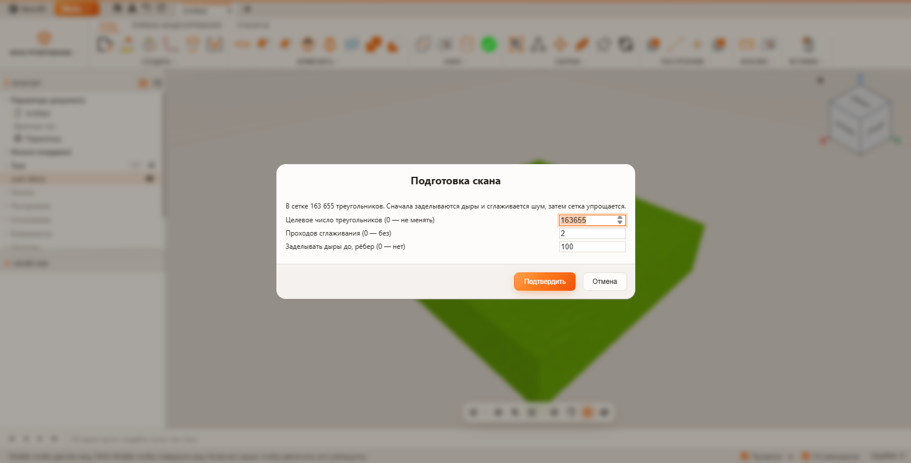
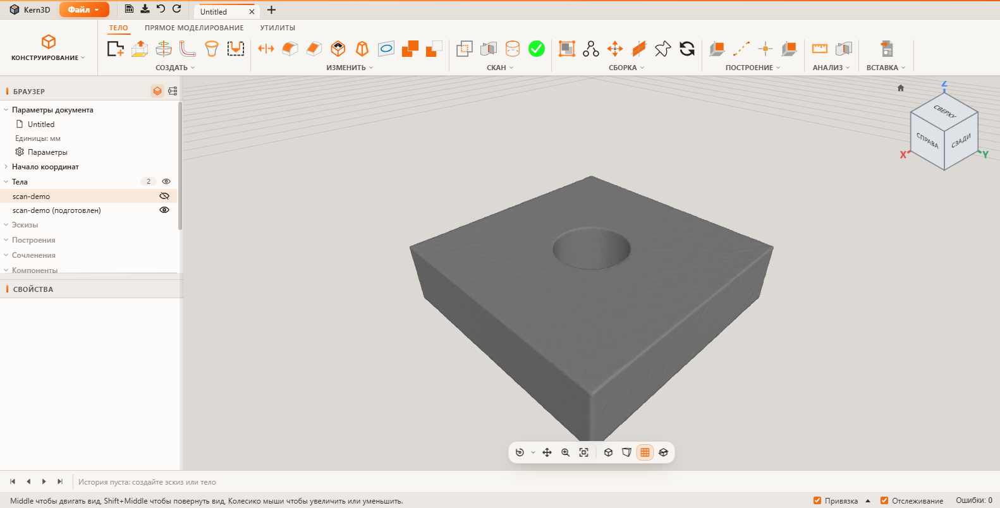
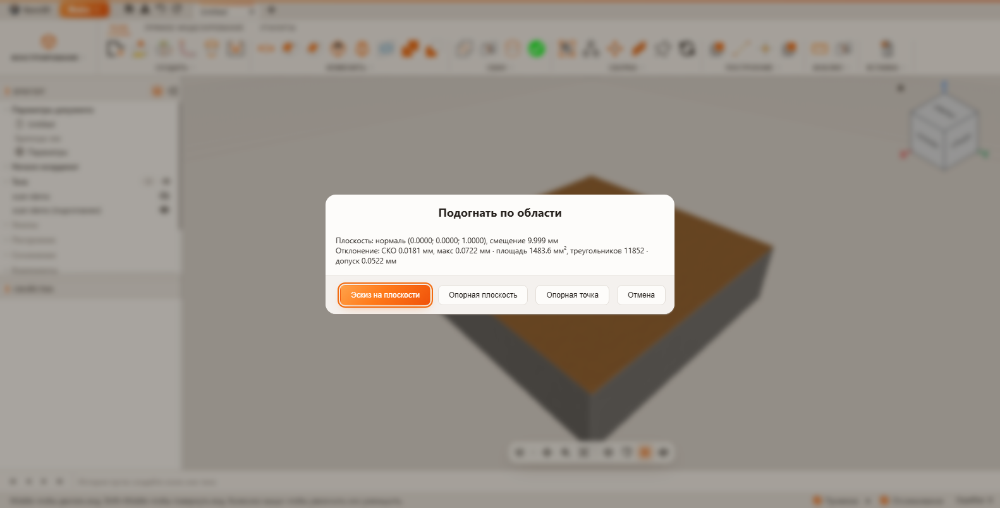
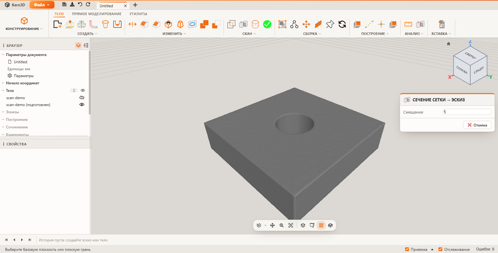
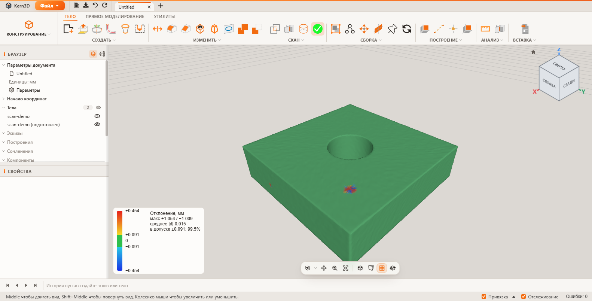
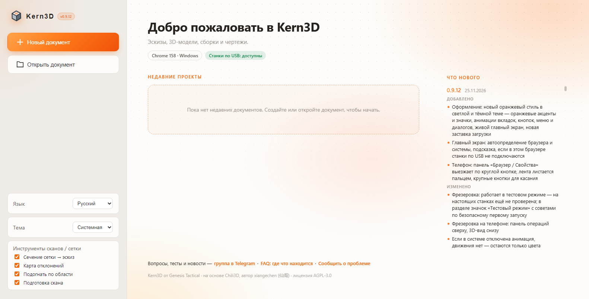

# STL и сканы → CAD

Подробное руководство: как из STL-файла или 3D-скана получить редактируемую CAD-модель и проверить, насколько она совпадает с оригиналом. Короткие ответы «где кнопка» — в [FAQ](../FAQ.md).

## Содержание

1. [Сначала разберитесь, что у вас за файл](#1-сначала-разберитесь-что-у-вас-за-файл)
2. [Импорт STL: тело или сетка](#2-импорт-stl-тело-или-сетка)
3. [Где кнопки](#3-где-кнопки)
4. [Перестроить операциями](#4-перестроить-операциями)
5. [Распознать цилиндры и Сделать редактируемым](#5-распознать-цилиндры-и-сделать-редактируемым)
6. [Инструменты «Скан»](#6-инструменты-скан)
   - [Подготовка скана](#61-подготовка-скана)
   - [Подогнать по области](#62-подогнать-по-области)
   - [Сечение сетки → эскиз](#63-сечение-сетки--эскиз)
   - [Карта отклонений](#64-карта-отклонений)
7. [Включение и выключение инструментов](#7-включение-и-выключение-инструментов)
8. [Готовые сценарии](#8-готовые-сценарии)
9. [На телефоне и планшете](#9-на-телефоне-и-планшете)
10. [Проблемы и решения](#10-проблемы-и-решения)

---

## 1. Сначала разберитесь, что у вас за файл

От этого зависит, какие инструменты нужны.

| | STL из CAD-программы | 3D-скан |
|---|---|---|
| Откуда | Экспорт из Fusion, Inventor, SolidWorks, Kern3D, файлы с Thingiverse/Printables | 3D-сканер, фотограмметрия |
| Как выглядит | Чистые плоские грани, острые рёбра, длинные тонкие треугольники | Мелкие треугольники одинакового размера, шероховатая поверхность, дыры там, где сканер «не увидел» |
| Размер | Обычно до 100 000 треугольников | Обычно сотни тысяч и миллионы |
| Что делать | **«Перестроить операциями»** ([раздел 4](#4-перестроить-операциями)) | Инструменты группы **«Скан»** ([раздел 6](#6-инструменты-скан)) |

> ⚠️ **«Подготовка скана» — только для настоящих сканов.** На чистом CAD-файле она ничего не улучшит (с версии 0.9.13 она его и не испортит: сглаживание ограничено уровнем шума, а у CAD-файла шума нет).

## 2. Импорт STL: тело или сетка

**Файл ▾ → Импорт (STL, STEP…)** или перетащите файл в окно.

- **До 100 000 треугольников** — STL превращается в **тело**: грани сшиваются, плоские участки объединяются, круглые отверстия распознаются как цилиндры. В дереве слева оно лежит в разделе «Тела». С телом работают все команды, в том числе «Перестроить операциями».
- **Больше 100 000 треугольников** — файл открывается как **сетка** (только треугольники, без граней). Превращать такой объём в тело слишком долго и ненадёжно. С сеткой работают инструменты группы «Скан»; «Перестроить операциями» с сеткой не работает.

Импорт идёт со шкалой прогресса. Большой файл может строиться несколько минут.

## 3. Где кнопки

Вкладка **«Тело»** (переключатель «Конструирование» слева должен стоять на «Конструирование»).

- Группа **«Изменить»** — столбик из трёх кнопок:
  - **Сделать редактируемым**
  - **Распознать цилиндры**
  - **Перестроить операциями**
- Группа **«Скан»** — сразу справа от «Изменить»:
  - **Подготовка скана**
  - **Сечение сетки → эскиз**
  - **Подогнать по области**
  - **Карта отклонений** (кнопка-переключатель)

Любую команду можно найти и через поиск команд по названию.

На узком экране лента прокручивается: если группа обрезана, проведите по ленте пальцем или колесом мыши.

## 4. Перестроить операциями

Превращает импортированное тело в **параметрическую модель из операций**: эскизы, выдавливания, отверстия, скругления, фаски — как если бы деталь нарисовали в Kern3D с нуля. Эскизы и размеры потом можно править.

### Как запустить

1. Выделите импортированное тело в дереве или в окне. Если ничего не выделено, программа попросит выбрать (можно несколько).
2. **«Тело» → «Изменить» → «Перестроить операциями»**.
3. Появится окно прогресса с этапами:
   - Разбор сетки
   - Сечения вдоль оси N из M
   - Операции
   - Сверка с исходной деталью
   - Скругления и фаски
   - Доработка расхождений
   - Проверка поверхности
   - Сложные участки
4. **Отмена** (или Esc) останавливает работу — документ остаётся как был.

### Что получится

- Новое тело встаёт в дереве сразу после исходного, рядом — его эскизы.
- **Исходное тело скрывается**, но не удаляется: включите глазик, чтобы сравнить, или используйте [карту отклонений](#64-карта-отклонений).
- Сообщение: «Перестроено тел: 1, отклонение от исходного до X %».
- Если точно перестроить не удалось (отклонение больше 5 %), результат **не сохраняется**: «Не удалось перестроить достаточно точно… тело оставлено как было».

### Сколько ждать

| Деталь | Время на ПК |
|---|---|
| Простая (кронштейн, пластина, крышка) | 10–60 с |
| Средняя (корпус с отверстиями с нескольких сторон) | 1–4 мин |
| Сложная (много граней, наклонные элементы) | до 10–15 мин |

На телефоне и слабых ноутбуках — заметно дольше. Время из прогонов на ПК (i5/i7), для ориентира.

### Что получается хорошо, что плохо

- ✅ Детали «из станка»: плоскости, отверстия, карманы, бобышки, пазы, скругления и фаски по рёбрам.
- ⚠️ Наклонные и вращённые элементы, сложные скругления — частично; остаток может быть сложен из «кусков».
- ❌ Органические формы (фигурки, рукоятки, скульптуры) — остаются сеткой, для них перестройка не предназначена.

### Только для тел

Команда принимает **импортированное тело без последующих операций**. Если вы уже что-то сделали с телом (вырезали, скруглили), или это сетка (большой STL, результат «Подготовки скана»), команда скажет: «Выберите импортированное тело без последующих операций».

## 5. Распознать цилиндры и Сделать редактируемым

- **Распознать цилиндры** — круглые отверстия и выступы STL из граней-«ёлочек» превращаются в настоящие цилиндры (для крепежа, резьбы, размеров). Для файлов до 100 000 треугольников делается автоматически при импорте; если сетка была большой, программа скажет «цилиндры не распознаны автоматически» — тогда нажмите вручную.
- **Сделать редактируемым** — импортированное тело становится обычным телом Kern3D, к которому можно применять любые операции (вырез, скругление, оболочка). Дерево операций при этом не строится — для этого «Перестроить операциями».

## 6. Инструменты «Скан»

Работают и с **сеткой** (большой STL, скан), и с **телом**.

### 6.1. Подготовка скана

Приводит сырой скан в порядок перед измерениями.

1. **«Скан» → «Подготовка скана»**, выберите сетку.
2. Диалог:
   - **Целевое число треугольников** (0 — не менять). По умолчанию 200 000. Меньше — быстрее работают остальные инструменты, но теряются мелкие детали.
   - **Проходов сглаживания** (0 — без). По умолчанию 2. Больше — глаже, но рёбра слегка скругляются.
   - **Заделывать дыры до, рёбер** (0 — нет). По умолчанию 100. Дыры большего размера остаются открытыми.
3. Результат — **новая сетка «… (подготовлен)»** рядом с исходной; исходная скрывается. Отменить — Ctrl+Z или удалить новую сетку и включить глазик у исходной.
4. Сообщение: «треугольников A → B, дыр заделано N (осталось M), шум X → Y мм».

Порядок обработки: сварка вершин → заделка дыр → сглаживание (без усадки детали) → упрощение до нужного числа треугольников.

Сглаживание не сдвигает поверхность дальше, чем позволяет шум скана (3 σ). Поэтому на чистой CAD-сетке оно ничего не меняет.

### 6.2. Подогнать по области

Находит на сетке простую поверхность и даёт её точные размеры.

1. **«Скан» → «Подогнать по области»**, выберите сетку.
2. **Щёлкните по сетке** на нужной поверхности — стенке, отверстию, выступу.
3. Программа найдёт гладкую область вокруг щелчка, подсветит её оранжевым и подберёт:
   - **плоскость** — нормаль и смещение;
   - **цилиндр** — Ø, ось, длина; отдельно определяет, **отверстие** это или **выступ**;
   - **конус** — угол при вершине;
   - **сферу** — Ø и центр;
   - **тор** — радиусы.
4. В окне — числа и качество подгонки: СКО и максимум отклонения, площадь, допуск.
5. Кнопки действий (зависят от найденной формы):
   - **Эскиз на плоскости** — новый эскиз прямо на этой стенке;
   - **Опорная плоскость**, **Ось**, **Опорная точка** / **Точка в центре** / **Точка в вершине** — опорная геометрия для дальнейшего построения;
   - **Эскиз отверстия (Ø)** — окружность нужного диаметра на нужном месте; вырез по ней сделайте сами («Выдавливание» → вырез);
   - **Бобышка (Ø × длина)** — готовое тело-цилиндр.

Если пишет «Область не описывается примитивом» — щёлкните ближе к середине поверхности, подальше от рёбер, или сначала сделайте «Подготовку скана» (шум мешает).

### 6.3. Сечение сетки → эскиз

Разрезает сетку плоскостью и превращает контур в **редактируемый эскиз**: линии, дуги, окружности, с совпадающими концами, горизонтальными/вертикальными стенками и размерами радиусов. Готов к выдавливанию или вращению.

1. **«Скан» → «Сечение сетки → эскиз»**, выберите сетку (или выделите её заранее).
2. Выберите плоскость: грань тела, опорную плоскость или XY / YZ / ZX.
   - У сетки граней нет, поэтому для скана удобно сначала сделать **«Подогнать по области» → «Опорная плоскость»** на нужной стенке.
   - Квадраты XY/YZ/ZX рисуются довольно крупно — на маленькой детали отдалите вид, чтобы их увидеть.
3. Поле **«Смещение»** сдвигает плоскость сечения по нормали.
4. Результат — эскиз «… — сечение». Сообщение: сколько контуров, с каким допуском, что не удалось описать.

Для скана допуск подбирается по шуму автоматически. Дыры скана в сечении перекрываются, если разрыв не больше 5 % размера детали. Стенки с наклоном до 0,5° к осям становятся строго горизонтальными/вертикальными.

Если пишет «Плоскость не пересекает сетку (или сечение не замкнуто…)» — проверьте положение плоскости и заделайте дыры «Подготовкой скана».

### 6.4. Карта отклонений

Раскрашивает **CAD-тело** по расстоянию до **эталонной сетки** (скана или исходного STL). Показывает, где модель совпадает с оригиналом, а где нет.

> Сравнивается **тело с сеткой**. Две сетки между собой не сравниваются — сначала нужно получить тело: «Перестроить операциями» или смоделировать самому.

1. **«Скан» → «Карта отклонений»** (кнопка остаётся нажатой).
2. Внизу появится «Выберите тело для карты отклонений» — щёлкните по телу.
3. Эталон выбирается сам:
   - скрытый исходник, который оставила «Перестроить операциями»;
   - иначе — единственная сетка в документе;
   - иначе программа попросит выбрать эталонную сетку.
4. Цвета:
   - 🟢 **зелёный** — в допуске (0,05 мм, для шумного скана — 3 σ шума);
   - 🔴 **красный** — тело выступает наружу из оригинала;
   - 🔵 **синий** — тело утоплено внутрь.
5. Легенда: максимум в обе стороны, среднее |d|, процент поверхности в допуске.
6. Чтобы убрать — нажмите кнопку ещё раз. Карта снимается сама при изменении тела (пересчитайте, нажав снова).

Выйти из ожидания выбора — **Esc**.

## 7. Включение и выключение инструментов

Каждый из четырёх инструментов «Скан» можно отключить.

**Стартовый экран** (щелчок по логотипу Kern3D или домик) → левая панель внизу → блок **«Инструменты сканов / сетки»** → галочки.

- Выключенный инструмент пропадает с ленты и из поиска команд; горячая клавиша отвечает «Инструмент выключен в настройках».
- Включение действует сразу, без перезагрузки. Настройка запоминается.

## 8. Готовые сценарии

### А. STL из CAD → редактируемая модель

1. Импорт STL (до 100 000 треугольников — станет телом).
2. Выделить тело → **«Перестроить операциями»** → дождаться.
3. **«Карта отклонений»** → щёлкнуть по новому телу → проверить, где красное/синее.
4. Править эскизы и операции в дереве (двойной щелчок).

### Б. Скан → CAD-модель по размерам

1. Импорт скана (откроется сеткой).
2. **«Подготовка скана»** — заделать дыры, убрать шум, при необходимости уменьшить до 100–200 тыс. треугольников.
3. **«Подогнать по области»** по базовой стенке → **«Опорная плоскость»** (или **«Эскиз на плоскости»**).
4. **«Сечение сетки → эскиз»** по этой плоскости → поправить эскиз → **«Выдавливание»**.
5. Отверстия: **«Подогнать по области»** по отверстию → **«Эскиз отверстия (Ø)»** → вырез.
6. Выступы: **«Подогнать по области»** → **«Бобышка»**.
7. **«Карта отклонений»** по готовому телу — проверка против скана.

### В. Снять размеры со скана, ничего не моделируя

**«Подогнать по области»** по нужным поверхностям — в окне Ø отверстий, расстояния плоскостей, углы конусов.

## 9. На телефоне и планшете

- Лента прокручивается пальцем; кнопки «Изменить» и «Скан» могут быть за краем экрана.
- Выбор и щелчки — касанием. Чтобы выйти из ожидания выбора, нажмите другую команду (Esc на телефоне нет, если не подключена клавиатура).
- Перестройка и подготовка скана считаются дольше, чем на ПК; памяти у браузера на телефоне меньше. Очень большие сканы лучше сначала уменьшить «Подготовкой скана» на ПК.

## 10. Проблемы и решения

| Что видите | Причина и что делать |
|---|---|
| «Выберите тело для карты отклонений» и ничего не происходит | Программа ждёт щелчка по **телу**. Если в документе только сетки — сначала «Перестроить операциями» или постройте тело. Выйти — Esc |
| «Выберите импортированное тело без последующих операций» | Выбрана сетка или тело, с которым уже что-то делали. Перестроить можно только свежеимпортированное тело |
| «Не удалось перестроить достаточно точно» | Деталь слишком сложная для автоматики. Используйте инструменты «Скан» и моделируйте вручную |
| После «Подготовки скана» деталь оплыла | Старая версия до исправления сглаживания. Удалите «(подготовлен)», включите исходник. Для CAD-файлов подготовка не нужна |
| «Область не описывается примитивом» | Щелчок попал на ребро или в шум. Щёлкните в середине поверхности; сделайте «Подготовку скана» |
| «Плоскость не пересекает сетку…» | Плоскость мимо детали или в сечении дыры. Сдвиньте «Смещением», заделайте дыры |
| Импорт большого STL идёт долго / окно не отвечает | Нормально для сотен тысяч треугольников — дождитесь шкалы. Больше 100 000 открывается сеткой |
| Кнопок группы «Скан» нет | Выключены в настройках ([раздел 7](#7-включение-и-выключение-инструментов)) |

Нашли ошибку — **«Сообщить о проблеме»** на стартовом экране, или пишите в [группу в Telegram](https://t.me/HPA_AirSoft_System_Development/71332).
